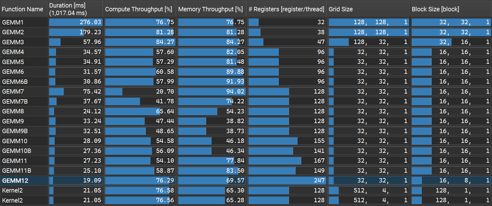
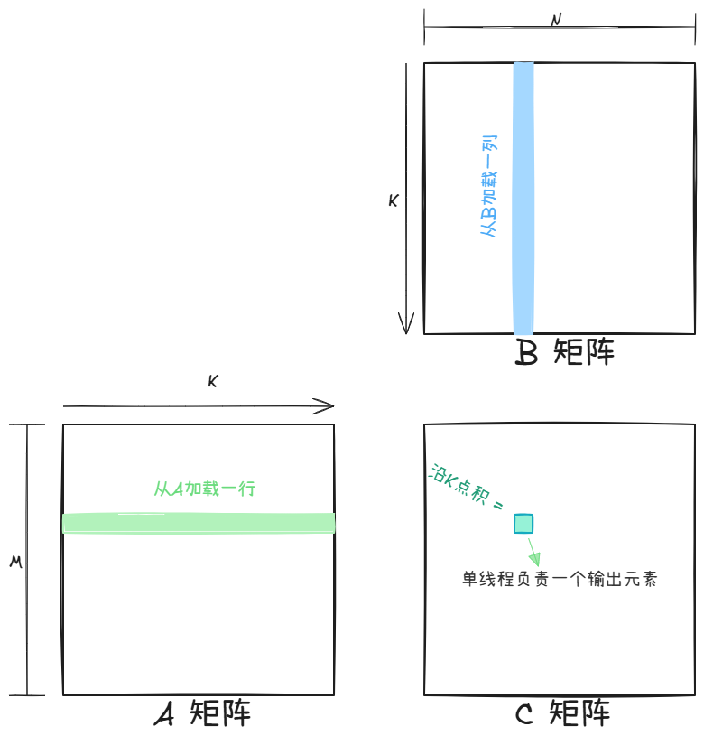
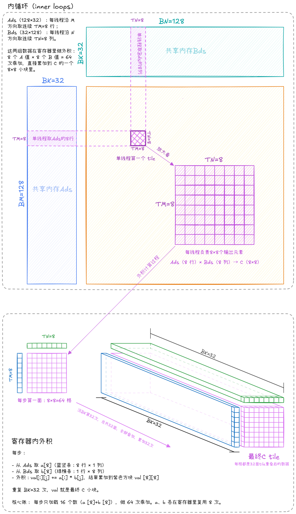
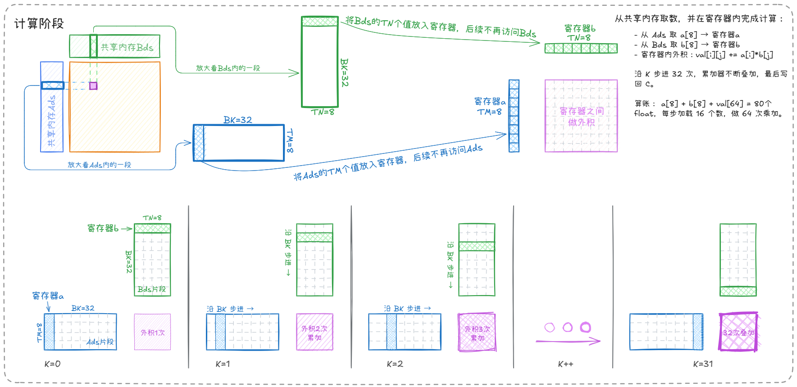
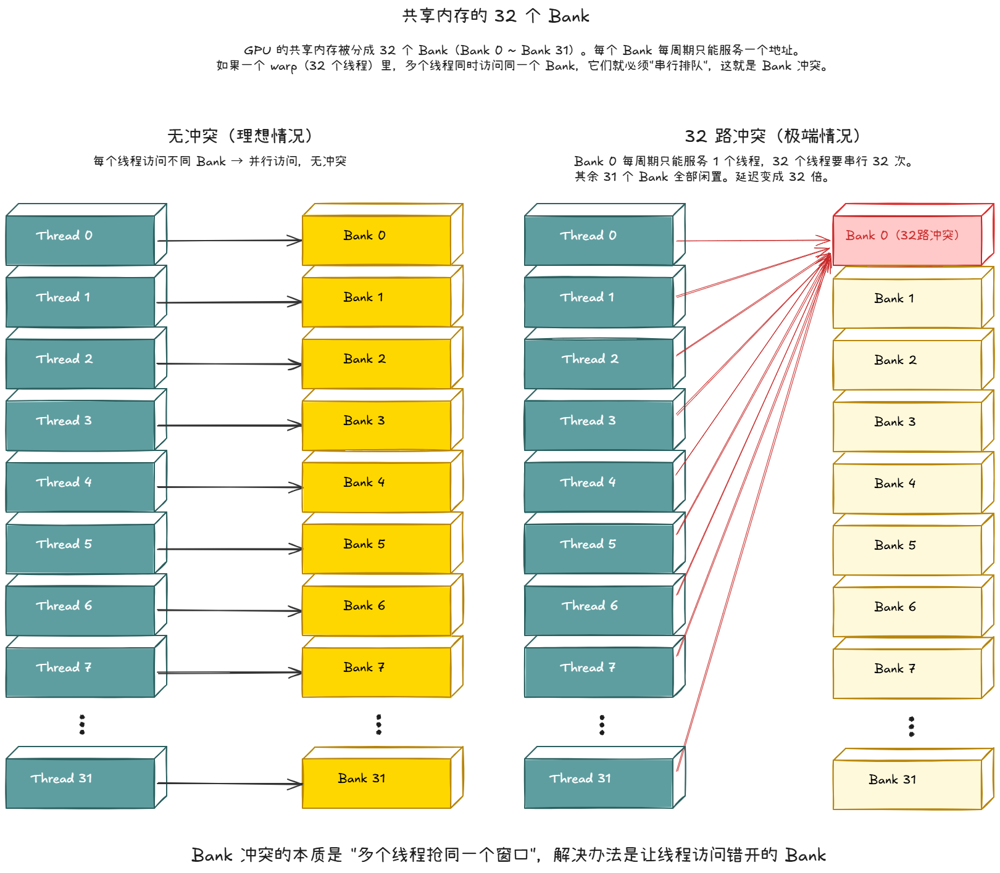

<div align="center">
  <h1>CUDA SGEMM 教学</h1>

  
  
  
  
  
  
</div>

<br>

从朴素 Kernel 到反超 cuBLAS，经过 12 个优化版本（共 17 个手写 kernel）。

包含共享内存分块、线程粗化、寄存器缓存、float4 向量化、XOR Swizzle、双缓冲、cp.async、寄存器软件流水、两级流水线、自定义分块形状。

最终在多数矩阵尺寸上跑赢 cuBLAS FP32。

<br>

## 测试环境

CUDA Event 计时，重复 100 次取平均值与中位数、交替采样、奇偶轮反转执行顺序，保护对比公平。

支持热缓存（不冲刷 L2）、冷缓存（冲刷 L2）两种模式。本仓库所有性能数据在冷缓存基础下测得。

同一台机器上分别用 `-arch=native` 和 `-arch=sm_80` 各实测一次，不同编译器调度的测试结果略有不同，但总体趋势一致。

RTX 5060 Laptop GPU（Blackwell，sm_120）`-arch=native`，中位数耗时：在 2048、3072、4096、5120、6144 五个尺寸上，GEMM12 分别达到 cuBLAS 的 115%、119%、110%、116%、115%。

**性能总览（-arch=native）：**


**性能总览（-arch=sm_80）：**


### 完整性能表（4096 尺寸，-arch=native）

主性能图只收录 11 个代表性版本，这里列出全部 19 个:

>全尺寸全版本数据见 [test/benchmark_native.txt](test/benchmark_native.txt) 与 [test/benchmark_sm80.txt](test/benchmark_sm80.txt)

| 阶段 | 版本 | 名称 | 核心内容 | 耗时 (ms) | TFLOPS | 占 cuBLAS % |
| --- | --- | --- | --- | ---: | ---: | ---: |
| 基线 | GEMM1 | 朴素移植 | block 32×32、一线程一元素 | 188.49 | 0.73 | 7.4% |
| 数据复用 | GEMM2 | 共享内存分块 | BM=BN=BK=32，把全局访存量从 O(MNK) 降下来 | 110.52 | 1.24 | 12.6% |
| 线程粗化 | GEMM3 | 一维线程粗化 | TM=8，单线程多元素，改善计算访存比 | 36.54 | 3.76 | 38.2% |
| 线程粗化 | GEMM4 | 二维线程粗化 | TM=TN=8，N 方向同样粗化 | 21.25 | 6.47 | 65.7% |
| 寄存器 | GEMM5 | 寄存器复用 | TM=TN=8，B 值先进寄存器、避免共享内存重复读 | 21.00 | 6.55 | 66.5% |
| 向量化 | GEMM6 | float4 访存向量化 | 128-bit LDG/STG，削减访存指令数 | 20.88 | 6.58 | 66.8% |
| 向量化 | GEMM6B | float4 计算向量化 | 128-bit LDS，削减计算阶段 LDS 指令数 | 18.58 | 7.40 | 75.1% |
| Bank 冲突 | GEMM7 | bank 冲突反例 | Bds[BN][BK] 转置布局，刻意展示的 bank 冲突的反面教材 | 42.32 | 3.25 | 33.0% |
| Bank 冲突 | GEMM7B | k_offset 旋转 | 加 k_offset 旋转，缓解计算阶段冲突 | 21.29 | 6.46 | 65.6% |
| Bank 冲突 | GEMM8 | XOR Swizzle | 用 XOR Swizzle 映射，同时化解加载与计算两处冲突 | 16.27 | 8.45 | 85.8% |
| 流水线 | GEMM9 | 朴素双缓冲 | 动态 SMEM 64 KB 双缓冲，但加载与计算仍串行 | 20.59 | 6.68 | 67.8% |
| 流水线 | GEMM9B | cp.async 双缓冲 | A 侧用 DMA，省发射槽 | 20.46 | 6.72 | 68.2% |
| 流水线 | GEMM10 | 寄存器流水 | issue/commit 拆分，让双缓冲真正形成流水 | 17.79 | 7.73 | 78.5% |
| 流水线 | GEMM10B | 混合流水 | A 侧 cp.async，省掉预取寄存器 | 16.82 | 8.17 | 83.0% |
| 两级流水 | GEMM11 | 两级双缓冲 | 转置布局 [BK][BM] + fragment 双缓冲，掩盖 SMEM→寄存器读延迟 | 17.80 | 7.72 | 78.4% |
| 两级流水 | GEMM11B | 两级 + cp.async | B 侧走 DMA，省加载指令 | 16.39 | 8.39 | 85.2% |
| 结构调优 | GEMM12 | 自定义分块 | BK=16、TM=16、TN=8、128 线程，平衡分块/寄存器/占用率 | 12.67 | 10.85 | 110.2% |
| 基准 | GEMM13 | cuBLAS (FP32) | 官方库上限对照 | 13.96 | 9.85 | 100.0% |
| 基准 | GEMM14 | cuBLASLt (FP32) | 官方库上限对照 | 14.46 | 9.50 | 96.5% |

### NCU 性能表（4096 尺寸，-arch=native）



<br>

---

## 预备知识

### GPU 的存储层级

CUDA kernel 能用的存储分四层，越往上越快、越小、越私有。

所有 GEMM 优化做的事，概括起来就是把数据从下层搬到上层，并在上层反复使用。


### 线程层级：Grid、Block、Thread

一个 kernel 启动后，GPU 上的线程组织成三级结构。

计算 C 矩阵时，Grid 内所有 block 铺满整个 C，每个 block 负责一个 tile，block 内每个线程再负责 tile 中的一个元素或一小块。


<br>

---

## 优化路线逐版本讲解

计算 `C = A @ B`，`A (M,K)`、`B (K,N)`、`C (M,N)` ，均为行主序。

下文代码片段按核心逻辑摘选而出，完整代码见 [GEMM.cu](GEMM.cu) 文件。

---

## GEMM1：朴素版

一个线程负责一个输出元素 `C[row][col]`，沿 K 串行读取 A 的一行和 B 的一列做点积。



```cpp
__global__ void GEMM1(float* C, const float* A, const float* B, int M, int N, int K) {
    // 每个线程计算一个输出元素 C[row, col]
    int row = blockIdx.y * blockDim.y + threadIdx.y;  // 全局行号
    int col = blockIdx.x * blockDim.x + threadIdx.x;  // 全局列号
    if (row < M && col < N) {  // 避免越界
        float sum = 0.0f;
        // 串行遍历 K 维度，完成点积
        for (int k = 0; k < K; k++)
            sum += A[row * K + k] * B[k * N + col];
        C[row * N + col] = sum;  // 每个线程写入自己负责的输出位
    }
}
```

| 版本 | 耗时(ms) | TFLOPS | 占cuBLAS % |
| --- | ---: | ---: | ---: |
| GEMM1 | 188.49 | 0.73 | 7.4% |

**一些问题：**
- 每个线程只算一个输出。每做一次 FMA，就要读两次全局内存，计算和访存的比例是 1:2，极低，SM 浮点运算单元跑不满，无法隐藏访存延迟。
- 每个 C 元素都要读一整行 A 和一整列 B，相同位置元素被重复读取，完成全部计算需要 2 * K * M * N。要知道全局内存访问延迟最高，频繁重复的访问浪费大量时间。

<br>

## GEMM2：共享内存分块

**GEMM1** 的问题在于"同一个数据被不同线程反复从全局内存读取"。

一个 32×32 的输出 tile 里，所有线程合起来只用到 32 行 A 和 32 列 B。

可以先把这两块数据搬到共享内存，块内线程再从共享内存读。这样一来，数据的反复读取发生在共享内存里而不是全局内存里。

**实现：**

把 A、B 各切分成 32x32 的小块（tile）。

每次循环加载一个 tile 到 shared memory，然后块内所有线程从 shared memory 里读取，共同计算对应的 32x32 输出。


```cpp
__global__ void GEMM2(float* C, const float* A, const float* B, int M, int N, int K) {
    constexpr int BK = 32, BM = 32, BN = 32;  // 共享内存边长大小
    // 把 A、B 的 32x32 tile 搬到 shared memory 让块内线程共享（本版核心优化）
    __shared__ float Ads[BM][BK];  // A 的 32x32 子块缓存
    __shared__ float Bds[BK][BN];  // B 的 32x32 子块缓存
    int ty = threadIdx.y, tx = threadIdx.x;
    int row = blockIdx.y * BM + ty;
    int col = blockIdx.x * BN + tx;
    // 每线程 1 个输出的累加器
    float sum = 0.0f;
    // 还是沿公共维度，但每次跨步 BK=32
    for (int tile = 0; tile < K; tile += BK) {
        // 协作加载 A 子块到共享内存
        Ads[ty][tx] = (row < M && tile + tx < K) ? A[row * K + tile + tx] : 0.0f;
        // 协作加载 B 子块到共享内存
        Bds[ty][tx] = (tile + ty < K && col < N) ? B[(tile + ty) * N + col] : 0.0f;
        // 等待所有线程完成加载
        __syncthreads();
        // 从共享内存中读取数据进行乘加
        for (int k = 0; k < BK; k++)
            sum += Ads[ty][k] * Bds[k][tx];
        // 同步，确保计算完成后再覆盖共享内存
        __syncthreads();
    }
    if (row < M && col < N) C[row * N + col] = sum;
}
```

| 版本 | 耗时(ms) | TFLOPS | 占cuBLAS % |
| --- | ---: | ---: | ---: |
| GEMM1 | 188.49 | 0.73 | 7.4% |
| GEMM2 | 110.52 | 1.24 | 12.6% |

**收益：**

A tile 的每个元素被 ty 方向的 32 个线程共用，B tile 的每个元素被 tx 方向的 32 个线程共用。

不用频繁访问全局内存，全局访存量从 O(M*N*K) 降到 O(M*N*K/32)，减少 32 倍。

另外因访问地址转移到延迟低得多的 shared memory，计算效率也得到一些提升。

<br>

---

## 关于线程粗化（GEMM3、GEMM4）

**GEMM2** 虽然优化了全局访存量，但每线程只算 1 个输出元素。内层 k 循环里每做 1 次 FMA 要读 2 次共享内存（Ads、Bds 各 1 次），计算访存比是 1:2，SM 的浮点运算单元每工作 1 拍就要等 2 次访存，大量空闲。

如果让一个线程同时算多个输出，读进寄存器的数据可以被多个累加器反复使用，这样每次访存能换来多次 FMA，这就是线程粗化（thread tiling）。

>寄存器是比共享内存更快的一级存储，把数据放到寄存器里复用，是后续优化的地基。

---

## GEMM3：一维线程粗化（TM=8）

**说明**：
- 每线程沿 M 方向负责 TM=8 个输出元素；B 值读 1 次、被 8 个累加器共享（参与 8 次 FMA）
- 每个内层 k 迭代：读 Ads 的 8 个值 + Bds 的 1 个值到寄存器，寄存器内做 8 次 FMA，计算访存比从 1:2 升到 8:9；
- block 改为 32×16=512 线程，覆盖 128×32 的输出 tile。


```cpp
__global__ void GEMM3(float* C, const float* A, const float* B, int M, int N, int K) {
    // TM=8 是本版的核心配置：每线程负责 8 行输出（一维粗化）
    constexpr int BK = 32, BM = 128, BN = 32, TM = 8;
    __shared__ float Ads[BM][BK];
    __shared__ float Bds[BK][BN];
    int ty = threadIdx.y, tx = threadIdx.x;
    int tid = ty * blockDim.x + tx;

    // 每线程的 TM=8 个寄存器累加器
    float val[TM] = {0.0f};

    for (int tile = 0; tile < K; tile += BK) {
        // 步长循环加载 A tile：每个线程加载多个元素
        for (int i = tid; i < BM * BK; i += blockDim.x * blockDim.y) {
            int m = i / BK, k = i % BK;
            Ads[m][k] = A[(blockIdx.y * BM + m) * K + tile + k];
        }
        // 步长循环加载 B tile
        for (int i = tid; i < BK * BN; i += blockDim.x * blockDim.y) {
            int k = i / BN, n = i % BN;
            Bds[k][n] = B[(tile + k) * N + blockIdx.x * BN + n];
        }
        __syncthreads();

        // 一维粗化：每线程沿 M 方向累加 TM 个输出，Bds 只读一次，复用 TM 次
        for (int k = 0; k < BK; k++) {
            float b_val = Bds[k][tx];
            for (int i = 0; i < TM; i++)
                val[i] += Ads[ty * TM + i][k] * b_val;
        }
        __syncthreads();
    }

    // 每线程沿 M 方向写入 TM 个输出
    for (int i = 0; i < TM; i++)
        C[(blockIdx.y * BM + ty * TM + i) * N + blockIdx.x * BN + tx] = val[i];
}
```

| 版本 | 耗时(ms) | TFLOPS | 占cuBLAS % |
| --- | ---: | ---: | ---: |
| GEMM2 | 110.52 | 1.24 | 12.6% |
| GEMM3 | 36.54 | 3.76 | 38.2% |

<br>

## GEMM4：二维线程粗化（TM=TN=8）

**GEMM3** 只粗化了 M 方向：B 值读 1 次、被 TM 个累加器共享；但 A 值每个仍只参与 1 次 FMA，N 方向没有任何复用，共享内存访问量仍然偏高。所以这版对 N 方向也进行粗化。

**说明**：
- 两方向同时粗化：每线程负责 TM×TN=64 个输出，设置一个二维形状的累加器；
- 每个内层 k 迭代：读 Ads 的 8 个值 + Bds 的 8 个值，做 64 次 FMA，计算访存比变成 64:16（4:1），比 GEMM3 的 8:9 进一步提升，计算单元喂得更饱；
- block 改为 16×16=256 线程，覆盖 128×128 的输出 tile，全局内存访存量减少至 1/128，进一步降低。



```cpp
__global__ void GEMM4(float* C, const float* A, const float* B, int M, int N, int K) {
    // 从一维粗化扩展到二维：TM=TN=8，每线程负责 64 个输出
    constexpr int BK = 32, BM = 128, BN = 128, TM = 8, TN = 8;
    __shared__ float Ads[BM][BK];
    __shared__ float Bds[BK][BN];
    int ty = threadIdx.y, tx = threadIdx.x;
    int tid = ty * blockDim.x + tx;

    // 每线程的 TM×TN=64 个寄存器累加器
    float val[TM][TN] = {0.0f};

    for (int tile = 0; tile < K; tile += BK) {
        for (int i = tid; i < BM * BK; i += blockDim.x * blockDim.y) {
            int m = i / BK, k = i % BK;
            Ads[m][k] = A[(blockIdx.y * BM + m) * K + tile + k];
        }
        for (int i = tid; i < BK * BN; i += blockDim.x * blockDim.y) {
            int k = i / BN, n = i % BN;
            Bds[k][n] = B[(tile + k) * N + blockIdx.x * BN + n];
        }
        __syncthreads();

        // 二维粗化计算：充分利用 64 个寄存器累加器
        for (int k = 0; k < BK; k++)
            for (int i = 0; i < TM; i++)
                for (int j = 0; j < TN; j++)
                    val[i][j] += Ads[ty * TM + i][k] * Bds[k][tx * TN + j];
        __syncthreads();
    }

    // 每线程沿 M、N 两个方向写回 TM×TN 个输出
    for (int i = 0; i < TM; i++)
        for (int j = 0; j < TN; j++)
            C[(blockIdx.y * BM + ty * TM + i) * N + blockIdx.x * BN + tx * TN + j] = val[i][j];
}
```

| 版本 | 耗时(ms) | TFLOPS | 占cuBLAS % |
| --- | ---: | ---: | ---: |
| GEMM3 | 36.54 | 3.76 | 38.2% |
| GEMM4 | 21.25 | 6.47 | 65.7% |

**注意**：线程粗化因子也不是越大越好，因子越大，累加器占用的寄存器数量越多，occupancy 开始下降，这会降低 SM 中可供切换的 warp 数量，使延迟隐藏能力降低。

<br>

## GEMM5：寄存器复用

看 **GEMM4** 内层三重循环：

```cpp
for k in BK:
  for i in TM:
    for j in TN:
      val[i][j] += Ads[ty*TM+i][k] * Bds[k][tx*TN+j]
```

Bds 的同一个值在 i 循环里被重复读了 TM 次。如果把 Bds 的这一行先读到寄存器（B 列预加载），就不用反复访问 shared。



> 这个方法在 SMEM 带宽成为瓶颈时收益明显

**实现**：
- 先读 B 的 TN 个值到寄存器数组 b_val[TN]。
- 再对每个 i，读一次 Ads 到寄存器，用 b_val 做 TN 次 FMA。（a不用显式定义数组，用标量效果一样）
- Bds 访问次数：TM*TN → TN。
- Ads 访问次数：TM*TN → TM。

```cpp
// 除计算阶段以外，所有代码与上版本完全相同，不再赘述
// 计算阶段
for (int k = 0; k < BK; k++) {
    // 本版核心：先把 B 的 TN 个值读到寄存器，之后 TM×TN 次 FMA 都不再访问 Bds
    float b_val[TN];
    for (int j = 0; j < TN; j++)
        b_val[j] = Bds[k][tx * TN + j];
    // 再读 A 的 TM 个值，做 TM*TN 次 FMA
    for (int i = 0; i < TM; i++) {
        float a_val = Ads[ty * TM + i][k];
        for (int j = 0; j < TN; j++)
            val[i][j] += a_val * b_val[j];
    }
}
__syncthreads();
```

**收益**：每 k 迭代共享内存读从 128 次降到 16 次（B 侧 64→8、A 侧 64→8），降为原来的 1/8

**代价**：多占 TN=8 个临时寄存器。

**GEMM5 和 GEMM2** 本质上做同一件事：把数据从慢的层级搬到快的层级，在快层级里反复使用，减少对慢层级的访问。
区别在于：GEMM2 是跨线程复用（共享内存），GEMM5 是线程内复用（寄存器）。

| 版本 | 耗时(ms) | TFLOPS | 占cuBLAS % |
| --- | ---: | ---: | ---: |
| GEMM4 | 21.25 | 6.47 | 65.7% |
| GEMM5 | 21.00 | 6.55 | 66.5% |

### 为什么没提速？编译器替 GEMM4 提前完成了寄存器复用

GEMM4 的 `TM/TN/BK` 全是编译期常量，nvcc 会把内层循环完全展开，并自动消除同一地址的重复共享内存读取（循环不变量外提 + 公共子表达式删除）。

所以 GEMM4 代码表面看着 "每轮 k 都重复读共享内存" ，但编译后的 SASS 与显式写寄存器缓存的 GEMM5 几乎相同。

**NCU 数据（上GEMM4，下GEMM5）**：


| Shared Load 指标 | GEMM4 | GEMM5 |
| --- | ---: | ---: |
| 加载请求数（LDS） | 335,544,320 | 335,544,320 |
| SMEM 吞吐占峰值（% Peak） | 76.66% | 75.98% |
| Bank Conflicts | 536,970,861 | 538,070,307 |

NCU 印证了这一点：两版 Shared Load 的 LDS 请求数一字不差（335,544,320），SMEM 吞吐占峰值均为约 76%，连 bank 冲突也几乎相同。SASS 层面没有可观测差异，性能持平。

>因为编译器辅助优化的原因，不是每一版的性能都有明显提升，但这不妨碍每版代码的教学意义。这种 "先放寄存器，再做 FMA" 的内层结构，是之后每个版本的基础。

<br>

## GEMM6：全局访存 float4 向量化

到目前为止，A/B 从全局到 shared 的搬运都是按 float 单个搬的。

每个 float（4字节）占用一条加载指令（LDG），4 字节的元素用一条 32 位的加载指令，效率不高。

CUDA 支持 `float4`，一条指令搬 16 字节（硬件对应 LDG.128 / STG.128），搬同样数据所需的指令数从 4 条降到 1 条（需地址 16 字节对齐，且矩阵尺寸能被 4 整除）。


**实现**：
- 全局 → shared 的循环改写成按 float4 展开。
- shared → 全局 的写回也用 float4。

```cpp
__global__ void GEMM6(float* C, const float* A, const float* B, int M, int N, int K) {
    constexpr int BK = 32, BM = 128, BN = 128, TM = 8, TN = 8;
    __shared__ float Ads[BM][BK];
    __shared__ float Bds[BK][BN];
    int ty = threadIdx.y, tx = threadIdx.x;
    int tid = ty * blockDim.x + tx;
    float val[TM][TN] = {0.0f};

    for (int tile = 0; tile < K; tile += BK) {
        // 使用 float4 向量化加载 A，减少访存指令
        for (int i = tid; i < BM * (BK / 4); i += blockDim.x * blockDim.y) {
            // i 是 float4 的索引，k 是 float4 的起始列号，k 一定是 4 的倍数
            int m = i / (BK / 4), k = (i % (BK / 4)) * 4;
            *(float4*)&Ads[m][k] = *(const float4*)&A[(blockIdx.y * BM + m) * K + tile + k];
        }
        // 使用 float4 向量化加载 B，减少访存指令
        for (int i = tid; i < BK * (BN / 4); i += blockDim.x * blockDim.y) {
            int k = i / (BN / 4), n = (i % (BN / 4)) * 4;
            *(float4*)&Bds[k][n] = *(const float4*)&B[(tile + k) * N + blockIdx.x * BN + n];
        }
        __syncthreads();

        // 本版计算阶段依然用标量
        for (int k = 0; k < BK; k++) {
            float b_val[TN];
            for (int j = 0; j < TN; j++)
                b_val[j] = Bds[k][tx * TN + j];
            for (int i = 0; i < TM; i++) {
                float a_val = Ads[ty * TM + i][k];
                for (int j = 0; j < TN; j++)
                    val[i][j] += a_val * b_val[j];
            }
        }
        __syncthreads();
    }

    // 使用 float4 向量化写回 C
    for (int i = 0; i < TM; i++)
        for (int j = 0; j < TN; j += 4) {
            float4 v = {val[i][j], val[i][j+1], val[i][j+2], val[i][j+3]};
            *(float4*)&C[(blockIdx.y * BM + ty * TM + i) * N + blockIdx.x * BN + tx * TN + j] = v;
        }
}
```

**收益**：
- 每个线程发出的访存指令数减少到原来的 1/4（4 条 LDG 变 1 条 LDG.128），
- 减轻 load/store 单元的发射压力，也让 SM 有更多指令槽留给 FMA。

| 版本 | 耗时(ms) | TFLOPS | 占cuBLAS % |
| --- | ---: | ---: | ---: |
| GEMM5 | 21.00 | 6.55 | 66.5% |
| GEMM6 | 20.88 | 6.58 | 66.8% |

> 所有尺寸的 GEMM6 经向量化优化后，性能数据均比 GEMM5 有显著提升，唯有这 4096 尺寸下，GEMM6 版本未见明显变化。查询了 SASS，GEMM5 加载和写回用的是 LDG.E 和 STG.E，GEMM6 用的是 STG.E.128 和 LDG.E.128，加载与写回指令确实减少，说明优化本身是生效的。可能是 4096 尺寸下编译器把 GEMM5 的代码调度到了异常好的状态，计算已能掩盖住全局加载，指令不是关键瓶颈。（我相信计算机没有秘密，但时间有限，我无法在这个点上继续深究）

<br>

### GEMM6B：计算阶段 float4

**GEMM6** 只向量化了访存阶段，计算阶段依然是标量加载（一条 LDS 读 4 字节）。

本版不改变任何布局、不引入 bank conflict，只在计算阶段把 Bds 的加载改成 float4 向量化，

Ads 的加载不使用 float4，因为 Ads[ty * TM + i][k] 里 i 是行方向，跨 BK 个步长，不连续，无法用一条 float4 指令加载。

```cpp
// 仅改动计算阶段
for (int k = 0; k < BK; k++) {
    // B 侧每 4 个 j 用一条 float4 读取，把 LDS 指令数压到 1/4
    float4 b_val4[TN / 4];
    for (int j = 0; j < TN; j += 4)
        b_val4[j / 4] = *(const float4*)&Bds[k][tx * TN + j];
    for (int i = 0; i < TM; i++) {
        float a_val = Ads[ty * TM + i][k];
        for (int j = 0; j < TN; j += 4) {
            val[i][j + 0] += a_val * b_val4[j / 4].x;
            val[i][j + 1] += a_val * b_val4[j / 4].y;
            val[i][j + 2] += a_val * b_val4[j / 4].z;
            val[i][j + 3] += a_val * b_val4[j / 4].w;
        }
    }
}
__syncthreads();
```

SASS（计算阶段，原B侧 LDS → LDS.128）：


```
LDS R.., [R77]           // A 侧标量读（跨行，不连续，无法合并，还是LDS）
LDS.128 R.., [R76]       // B 侧 8 个连续元素 → 编译器自动合并成 2 条 128 位
LDS R.., [R77+0x80*i]    // A 侧其余 7 个
LDS.128 R.., [R76+0x10]
FFMA
```

| 版本 | 耗时(ms) | TFLOPS | 占cuBLAS % |
| --- | ---: | ---: | ---: |
| GEMM6 | 20.88 | 6.58 | 66.8% |
| GEMM6B | 18.58 | 7.40 | 75.1% |

<br>

## 关于共享内存 Bank 冲突（GEMM7、GEMM7B、GEMM8）

共享内存被组织成 32 个 bank（bank 编号按 "地址%32" 计算）。一个 warp 访问共享内存时，如果 32 个线程落在 32 个不同 bank，一次就能取完；如果有多个线程落在同一个 bank，硬件只能把它们串行化排队执行，叫 **bank conflict**。

>冲突路数 = 同一 bank 上串行的线程数量，n 路冲突意味着吞吐量掉到理论值的 1/n。



## GEMM7：转置布局反例（刻意保留的负面教材）

**动机**：GEMM6B 已经量化过：计算阶段用 float4 能带来一点提升。而且 GEMM6B 只在加载 Bds 时使用 float4，加载 Ads 仍然是标量，那如果把 Ads 也改成用 float4，能不能再提升一点呢？

既然 float4 要求数据沿连续的方向存储，一个自然的想法就是："把 Bds 的布局从 `[BK][BN]` 改成 `[BN][BK]`，这样就和 Ads 的布局一致，两者都沿 K 连续，就都可以用 float4 加载了。"

```cpp
__global__ void GEMM7(float* C, const float* A, const float* B, int M, int N, int K) {
    constexpr int BK = 32, BM = 128, BN = 128, TM = 8, TN = 8;
    __shared__ float Ads[BM][BK];
    // 本版核心：B 在 shared 里改成 [BN][BK] 布局，沿 k 方向连续，才能用 float4 读
    // 代价是计算阶段会出现 bank conflict
    __shared__ float Bds[BN][BK];
    int ty = threadIdx.y, tx = threadIdx.x;
    int tid = ty * blockDim.x + tx;
    float val[TM][TN] = {0.0f};

    for (int tile = 0; tile < K; tile += BK) {
        // A：直接 float4 加载到 Ads[BM][BK]
        for (int i = tid; i < BM * (BK / 4); i += blockDim.x * blockDim.y) {
            int m = i / (BK / 4), k = (i % (BK / 4)) * 4;
            *(float4*)&Ads[m][k] = *(const float4*)&A[(blockIdx.y * BM + m) * K + tile + k];
        }
        // B：从全局 B(K, N) 读取连续 n 方向的 float4，写入 shared 时转置为 Bds[BN][BK]
        // 此处会产生 bank conflict（所有线程命中同一列 k）
        for (int i = tid; i < BK * (BN / 4); i += blockDim.x * blockDim.y) {
            int k = i / (BN / 4), n = (i % (BN / 4)) * 4;
            float4 v = *(const float4*)&B[(tile + k) * N + blockIdx.x * BN + n];
            Bds[n + 0][k] = v.x;
            Bds[n + 1][k] = v.y;
            Bds[n + 2][k] = v.z;
            Bds[n + 3][k] = v.w;
        }
        __syncthreads();

        // 朴素 k 访问：所有线程共同沿着 k=0 偏移，命中同一个 bank
        for (int k = 0; k < BK; k += 4) {
            float4 b_val[TN];
            for (int j = 0; j < TN; j++)
                b_val[j] = *(const float4*)&Bds[tx * TN + j][k];
            for (int i = 0; i < TM; i++) {
                float4 a_val = *(const float4*)&Ads[ty * TM + i][k];
                for (int j = 0; j < TN; j++) {
                    val[i][j] += a_val.x * b_val[j].x;
                    val[i][j] += a_val.y * b_val[j].y;
                    val[i][j] += a_val.z * b_val[j].z;
                    val[i][j] += a_val.w * b_val[j].w;
                }
            }
        }
        __syncthreads();
    }

    for (int i = 0; i < TM; i++)
        for (int j = 0; j < TN; j += 4) {
            float4 v = {val[i][j], val[i][j+1], val[i][j+2], val[i][j+3]};
            *(float4*)&C[(blockIdx.y * BM + ty * TM + i) * N + blockIdx.x * BN + tx * TN + j] = v;
        }
}
```

然而代价随之而来...

| 版本 | 耗时(ms) | TFLOPS | 占cuBLAS % |
| --- | ---: | ---: | ---: |
| GEMM6B | 18.58 | 7.40 | 75.1% |
| GEMM7 | 42.32 | 3.25 | 33.0% |

#### 为什么性能腰斩？

布局一改，加载阶段和计算阶段的 bank 分布变化，加载与计算阶段都出现冲突：

- **加载写入**： 共享内存的 bank 编号 = 地址 % 32，`Bds[n][k]` 的地址 = n×32 + k，**每行正好是 32 的倍数**，所以行号 n 贡献的偏移在取余数时被**整个消掉**。结果**bank 只看列号 k，行号 n 不起作用**。同一列的所有行，全堵在同一个 Bank 里，形成 32 路冲突。
- **计算读取**： `Bds[tx*TN+j][k]`，bank = k%32，block 16×16 里 16 个不同行号的线程全堵在 bank k 上 → 16 路冲突；

#### 难道 GEMM6 没有冲突吗？

GEMM6 的 `Bds[k][n]` 是 `[32][128]`，行宽 128 同样是 32 的倍数，bank = n % 32。计算阶段读 `Bds[k][tx×8+j]`，同一时刻 j 固定，`tx×8` 对 32 取余有 0、8、16、24 四个值，32 个线程被分到 4 个 bank → **4-way 冲突**（NCU 实测平均 3.2-way），损失较小。

GEMM7 把 Bds 改成 `[128][32]`，行宽 32，bank = k % 32，warp 内所有线程的 k 都一样，挤进同一个 bank：加载 32 路、计算 16 路，吞吐掉到 1/16 ~ 1/32，损失很大。

> bank conflict 是隐蔽的性能杀手。布局一改，bank 分布跟着变，可能引入冲突。改布局需特别注意。

### GEMM7B：k_offset 循环移位（消除计算阶段的冲突）

GEMM7 已经把 B 布局改成了 [BN][BK]。既然引起了冲突，就来消除冲突，本版在不放弃这个布局的前提下，尝试把它带来的冲突修掉。

首先只看**计算阶段**的冲突：GEMM7 冲突根源之一是"warp 内所有线程访问相同的 k 列"，如果让不同线程从不同的 k 开始访问，就能把访问分散到不同的 bank。

**实现**：和 GEMM7 相比只改一处：计算循环里 k 的起点：
```cpp
// GEMM7：
for (k = 0; k < BK; k += 4) {}

// GEMM7B：用 k_offset 旋转，不同线程从不同 k 开始，打散 bank
for (int k_offset = tid * 4; k_offset < BK + tid * 4; k_offset += 4) {
    int k = k_offset % BK;
    // 这样线程 tid 从 k = tid*4 开始，绕一圈回到起始位置。warp 内 32 个线程的起始 k 各不相同，访问时落在不同的 bank。
    // ...其他代码全部一样
}
```

warp 内 32 个线程起始 k 各不相同，访问分散到不同 bank，计算阶段冲突从 16 路降到 2 路。

| 版本 | 耗时(ms) | TFLOPS | 占cuBLAS % |
| --- | ---: | ---: | ---: |
| GEMM7 | 42.32 | 3.25 | 33.0% |
| GEMM7B | 21.29 | 6.46 | 65.6% |

k_offset 只解决了计算阶段的冲突，加载阶段转置写入 Bds[BN][BK] 的代码一字未改，warp 内所有线程仍在写同一列 k，bank = k，是 32 路冲突。

所以在加载阶段， GEMM7B 要比 GEMM6 慢得多，即使修复计算阶段冲突，性能也比 GEMM6 低。

下一版 GEMM8 用 XOR Swizzle 同时消除加载与计算两个阶段的冲突。

<br>

## GEMM8：XOR Swizzle

**优化原理**：不改变物理存储大小，通过按位异或把"行号的一部分位"混入"列地址"，让相同列 k 在不同行 n 上落到不同的 bank：

```cpp
auto swizzle = [](int n, int k) {
    int c   = k / 4;                // 第几个 float4 块（0~7）
    int off = k % 4;                // float4 块内偏移
    int sc  = c ^ ((n / 8) % 8);    // 行号特征混入列块号
    return sc * 4 + off;            // 拼回最终列号，仍是 4 的倍数
};
```

拆解：`k>>2` 把列号按 float4 分块；`(n>>3)&7` 提取行号高 3 位、区分不同线程的行区间；异或把行号特征混进列块索引，相同列在不同行映射到不同 bank；`<<2 | (k&3)` 还原列地址并保留块内偏移，float4 对齐不被破坏。

**效果**：加载阶段 32 路 → 4 路，计算阶段 16 路 → 2 路，且保留 float4 指令优势。对比 GEMM6：加载持平、B 计算从 4 路降到 2 路，全面更优。
与 k_offset 的关系：k_offset 只解决计算阶段；swizzle 让相同 k 在不同 n 落到不同 bank，加载和计算两处同时解决。本版删除 k_offset，改回普通 `k = 0~BK` 循环。


```cpp
__global__ void GEMM8(float* C, const float* A, const float* B, int M, int N, int K) {
    constexpr int BK = 32, BM = 128, BN = 128, TM = 8, TN = 8;
    __shared__ float Ads[BM][BK];
    // 保持 [BN][BK] 布局，计算阶段才能用 float4 读连续 k
    __shared__ float Bds[BN][BK];
    int ty = threadIdx.y, tx = threadIdx.x;
    int tid = ty * blockDim.x + tx;

    // 本版核心：XOR Swizzle 地址映射，以 float4 为粒度，不破坏对齐
    // 输入：n 行号（BN 方向），k 列号（BK 方向，4 的倍数）
    // 输出：搅乱后的新列号，仍是 4 的倍数，float4 读取仍对齐
    auto swizzle = [](int n, int k) {
        int c   = k / 4;                // 算k在第几个 float4 块里
        int off = k % 4;                // 算k在块里是第几个元素
        int sc  = c ^ ((n / 8) % 8);   // 用行号把列块号搅乱
        return sc * 4 + off;            // 拼回最终的列号
    };

    float val[TM][TN] = {0.0f};
    for (int tile = 0; tile < K; tile += BK) {
        // A：float4 加载到 Ads[BM][BK]，无 swizzle
        // 加载阶段为 4-way 冲突，但相比 B 侧的 32-way 风险可控，且计算阶段只有 2-way，加 swizzle 会破坏计算阶段的 float4 连续读取。还收益小，不额外引入 swizzle
        for (int i = tid; i < BM * (BK / 4); i += blockDim.x * blockDim.y) {
            int m = i / (BK / 4), k = (i % (BK / 4)) * 4;
            *(float4*)&Ads[m][k] = *(const float4*)&A[(blockIdx.y * BM + m) * K + tile + k];
        }
        // B：全局读 float4（n 方向连续），写入 shared 时转置为 Bds[BN][BK]
        // 写入地址套上 swizzle，把原来 32-way 的转置写入冲突降到 4-way
        for (int i = tid; i < BK * (BN / 4); i += blockDim.x * blockDim.y) {
            int k = i / (BN / 4), n = (i % (BN / 4)) * 4;
            float4 v = *(const float4*)&B[(tile + k) * N + blockIdx.x * BN + n];
            // 因为 n..n+3 的 (n+d)>>3 相同，swizzle 值一样，只算一次
            int s = swizzle(n, k);
            Bds[n + 0][s] = v.x;
            Bds[n + 1][s] = v.y;
            Bds[n + 2][s] = v.z;
            Bds[n + 3][s] = v.w;
        }
        __syncthreads();

        // 计算阶段：本版删除 k_offset，改回普通 k = 0~BK 遍历（swizzle 已经让相同 k 在不同 n 上落到不同 bank，不需要旋转 k 起点）
        for (int k = 0; k < BK; k += 4) {
            float4 b_val[TN];
            for (int j = 0; j < TN; j++)
                b_val[j] = *(const float4*)&Bds[tx * TN + j][swizzle(tx * TN + j, k)];
            for (int i = 0; i < TM; i++) {
                float4 a_val = *(const float4*)&Ads[ty * TM + i][k];
                for (int j = 0; j < TN; j++) {
                    val[i][j] += a_val.x * b_val[j].x;
                    val[i][j] += a_val.y * b_val[j].y;
                    val[i][j] += a_val.z * b_val[j].z;
                    val[i][j] += a_val.w * b_val[j].w;
                }
            }
        }
        __syncthreads();
    }

    for (int i = 0; i < TM; i++)
        for (int j = 0; j < TN; j += 4) {
            float4 v = {val[i][j], val[i][j+1], val[i][j+2], val[i][j+3]};
            *(float4*)&C[(blockIdx.y * BM + ty * TM + i) * N + blockIdx.x * BN + tx * TN + j] = v;
        }
}
```


加载和计算两处套同一个映射，冲突从 32/16 路降到 4/2 路。4096 尺寸 8.45 TFLOPS，比 GEMM6B 高 14%。XOR Swizzle 是解决 bank 冲突的通用方案，后续 GEMM9–GEMM12 全部沿用 swizzle 布局。

<br>
| 版本 | 耗时(ms) | TFLOPS | 占cuBLAS % |
| --- | ---: | ---: | ---: |
| GEMM7B | 21.29 | 6.46 | 65.6% |
| GEMM8 | 16.27 | 8.45 | 85.8% |

## 阶段七：双缓冲与软件流水（GEMM9、GEMM9B、GEMM10、GEMM10B）

**遗留问题**：到目前为止，每个 tile 的处理都是"加载 → 同步 → 计算 → 同步"，加载和计算严格串行——SM 在加载时计算闲置、在计算时内存闲置。硬件的加载单元和计算单元本来是独立的，把它们的工作错开，就能让两边同时忙碌。

### GEMM9：朴素双缓冲（负优化反例）

**做了什么**：共享内存开两份 buffer（`Ads[2][BM][BK]`、`Bds[2][BN][BK]`）。处理 tile t 时用 buf_0 计算、同时把 tile t+1 加载进 buf_1，下一轮互换，两份 buffer 交替使用（ping-pong）。共享内存翻倍到 64 KB，需要用 `cudaFuncSetAttribute` 提高单 block 动态共享内存上限。

**为什么反而变慢**：加载下一 tile 的整段代码排在计算前面，LDG 一口气全发、STS 跟着全写完，warp 才进入计算。编译器找不到"加载与计算交错"的调度点：

- LDG 的数百周期延迟没有被任何计算覆盖——双缓冲开了，却没有形成流水；
- 共享内存翻倍到 64 KB，occupancy 被拉低。

这是"写了双缓冲不等于有流水线"的典型案例。


```cpp
__global__ void GEMM9(float* C, const float* A, const float* B, int M, int N, int K) {
    constexpr int BK = 32, BM = 128, BN = 128, TM = 8, TN = 8;
    extern __shared__ char smem[];
    // shared memory 开两份 buffer，这是本版核心：
    // Ads/Bds 的第一维大小 2 是双缓冲 buffer 维度
    auto& Ads = *reinterpret_cast<float (*)[2][BM][BK]>(smem);
    auto& Bds = *reinterpret_cast<float (*)[2][BN][BK]>(smem + 2 * BM * BK * sizeof(float));
    int ty = threadIdx.y, tx = threadIdx.x;
    int tid = ty * blockDim.x + tx;
    auto swizzle = [](int n, int k) {
        int c   = k >> 2;
        int off = k & 3;
        int sc  = c ^ ((n >> 3) & 7);
        return (sc << 2) | off;
    };
    float val[TM][TN] = {0.0f};
    int buf = 0;  // 当前计算用的 buffer 索引，加载下一 tile 时切换到另一个

    // 预加载 tile 0 到 buf 0
    for (int i = tid; i < BM * (BK / 4); i += blockDim.x * blockDim.y) {
        int m = i / (BK / 4), k = (i % (BK / 4)) * 4;
        *(float4*)&Ads[0][m][k] = *(const float4*)&A[(blockIdx.y * BM + m) * K + k];
    }
    for (int i = tid; i < BK * (BN / 4); i += blockDim.x * blockDim.y) {
        int k = i / (BN / 4), n = (i % (BN / 4)) * 4;
        float4 v = *(const float4*)&B[k * N + blockIdx.x * BN + n];
        int s = swizzle(n, k);
        Bds[0][n + 0][s] = v.x;
        Bds[0][n + 1][s] = v.y;
        Bds[0][n + 2][s] = v.z;
        Bds[0][n + 3][s] = v.w;
    }
    __syncthreads();

    // 主循环：预加载下一 tile，计算当前 tile
    for (int tile = 0; tile < K; tile += BK) {
        int next_tile = tile + BK;
        int next_buf = 1 - buf;
        // 加载下一 tile 到 next_buf
        if (next_tile < K) {
            for (int i = tid; i < BM * (BK / 4); i += blockDim.x * blockDim.y) {
                int m = i / (BK / 4), k = (i % (BK / 4)) * 4;
                *(float4*)&Ads[next_buf][m][k] = *(const float4*)&A[(blockIdx.y * BM + m) * K + next_tile + k];
            }
            for (int i = tid; i < BK * (BN / 4); i += blockDim.x * blockDim.y) {
                int k = i / (BN / 4), n = (i % (BN / 4)) * 4;
                float4 v = *(const float4*)&B[(next_tile + k) * N + blockIdx.x * BN + n];
                int s = swizzle(n, k);
                Bds[next_buf][n + 0][s] = v.x;
                Bds[next_buf][n + 1][s] = v.y;
                Bds[next_buf][n + 2][s] = v.z;
                Bds[next_buf][n + 3][s] = v.w;
            }
        }
        // 计算当前 buf
        for (int k = 0; k < BK; k += 4) {
            float4 b_val[TN];
            for (int j = 0; j < TN; j++)
                b_val[j] = *(const float4*)&Bds[buf][tx * TN + j][swizzle(tx * TN + j, k)];
            for (int i = 0; i < TM; i++) {
                float4 a_val = *(const float4*)&Ads[buf][ty * TM + i][k];
                for (int j = 0; j < TN; j++) {
                    val[i][j] += a_val.x * b_val[j].x;
                    val[i][j] += a_val.y * b_val[j].y;
                    val[i][j] += a_val.z * b_val[j].z;
                    val[i][j] += a_val.w * b_val[j].w;
                }
            }
        }
        __syncthreads();
        buf = next_buf;  // 切换 buffer，下一轮用刚加载好的那份
    }

    for (int i = 0; i < TM; i++)
        for (int j = 0; j < TN; j += 4) {
            float4 v = {val[i][j], val[i][j+1], val[i][j+2], val[i][j+3]};
            *(float4*)&C[(blockIdx.y * BM + ty * TM + i) * N + blockIdx.x * BN + tx * TN + j] = v;
        }
}
```


诚实交代：这一版是负优化。4096 尺寸 native 6.68 TFLOPS（0.79×）——预取整段排在计算前面，LDG 延迟没被覆盖，64 KB 共享内存还压低了占用率。这正是 GEMM10 要解决的问题。

### GEMM9B：cp.async 双缓冲

| 版本 | 耗时(ms) | TFLOPS | 占cuBLAS % |
| --- | ---: | ---: | ---: |
| GEMM8 | 16.27 | 8.45 | 85.8% |
| GEMM9 | 20.59 | 6.68 | 67.8% |

**背景**：cp.async 是 sm_80 引入的异步拷贝指令，一条指令把数据从全局内存直接搬进共享内存，**不经过寄存器、不占用 warp 发射槽**——warp 发完立即返回，DMA 引擎在后台搬运，搬运和计算是真正的并行。

同步机制 `commit_group` / `wait_group`：指令发出 ≠ 数据到位，需要用"组"管理流水进度：

```cpp
cp.async.commit_group;    // 把已发出的拷贝打包成一组
cp.async.wait_group N;    // 最多允许 N 组还没完成，其余组必须完成
```

循环里为什么用 `wait_group 1`：处理 tile 时流水里恰好有两组在飞——本轮刚提交的 next tile（允许没搬完，后台继续）和上一轮提交的 current tile（必须已就绪，马上要算）。`wait_group 1` 的含义就是"第 2 组必须完成，第 1 组可以没完成"。

**为什么只有半流水**：B 需要转置 + swizzle 才能写进共享内存，而 cp.async 只能做直线拷贝，所以 B 仍走"LDG 到寄存器再 STS 写入"的普通路径，真正异步的只有 A。。


```cpp
__global__ void GEMM9B(float* C, const float* A, const float* B, int M, int N, int K) {
    constexpr int BK = 32, BM = 128, BN = 128, TM = 8, TN = 8;
    extern __shared__ char smem[];
    // 双缓冲 shared memory（架构与 GEMM9 相同）
    auto& Ads = *reinterpret_cast<float (*)[2][BM][BK]>(smem);
    auto& Bds = *reinterpret_cast<float (*)[2][BN][BK]>(smem + 2 * BM * BK * sizeof(float));
    int ty = threadIdx.y, tx = threadIdx.x;
    int tid = ty * blockDim.x + tx;
    auto swizzle = [](int n, int k) {
        int c   = k >> 2;
        int off = k & 3;
        int sc  = c ^ ((n >> 3) & 7);
        return (sc << 2) | off;
    };
    float val[TM][TN] = {0.0f};
    int buf = 0;  // 当前计算用的 buffer 索引，加载下一 tile 时切换到另一个
    // 本版核心：用 cp.async 发出下一 tile 的加载，异步 DMA，不占 warp 指令发射
    auto load_tile_async = [&](int b, int tile) {  // b 是 buffer（0/1），tile 是 K 段
        // A 可以用 cp.async 直接拷贝
        for (int i = tid; i < BM * (BK / 4); i += blockDim.x * blockDim.y) {
            int m = i / (BK / 4), k = (i % (BK / 4)) * 4;
            asm volatile("cp.async.ca.shared.global [%0], [%1], 16;"
                : : "l"(&Ads[b][m][k]), "l"(&A[(blockIdx.y * BM + m) * K + tile + k]) : "memory");
        }
        // B 无法用 cp.async 直接转置，用普通 float4 加载 + 共享内存写入转置
        for (int i = tid; i < BK * (BN / 4); i += blockDim.x * blockDim.y) {
            int k = i / (BN / 4), n = (i % (BN / 4)) * 4;
            float4 v = *(const float4*)&B[(tile + k) * N + blockIdx.x * BN + n];
            int s = swizzle(n, k);
            Bds[b][n + 0][s] = v.x;
            Bds[b][n + 1][s] = v.y;
            Bds[b][n + 2][s] = v.z;
            Bds[b][n + 3][s] = v.w;
        }
    };
    // 预加载 tile 0 并等待它到位
    load_tile_async(0, 0);
    asm volatile("cp.async.commit_group;" ::: "memory");
    asm volatile("cp.async.wait_group 0;" ::: "memory");
    __syncthreads();

    // 主循环：预加载下一 tile，计算当前 tile
    for (int tile = 0; tile < K; tile += BK) {
        int next_tile = tile + BK;
        int next_buf = 1 - buf;
        // 发出下一 tile 的异步拷贝，并提交为一组
        if (next_tile < K) {
            load_tile_async(next_buf, next_tile);
            asm volatile("cp.async.commit_group;" ::: "memory");
        }
        if (next_tile < K)
            asm volatile("cp.async.wait_group 1;" ::: "memory");  // wait_group 1：允许最新的 1 组（next tile）还没完成，前面的组必须完成
        else
            asm volatile("cp.async.wait_group 0;" ::: "memory");  // 最后一轮全等
        __syncthreads();
        // 计算当前 buf
        for (int k = 0; k < BK; k += 4) {
            float4 b_val[TN];
            for (int j = 0; j < TN; j++)
                b_val[j] = *(const float4*)&Bds[buf][tx * TN + j][swizzle(tx * TN + j, k)];
            for (int i = 0; i < TM; i++) {
                float4 a_val = *(const float4*)&Ads[buf][ty * TM + i][k];
                for (int j = 0; j < TN; j++) {
                    val[i][j] += a_val.x * b_val[j].x;
                    val[i][j] += a_val.y * b_val[j].y;
                    val[i][j] += a_val.z * b_val[j].z;
                    val[i][j] += a_val.w * b_val[j].w;
                }
            }
        }
        __syncthreads();
        buf = next_buf;
    }
    for (int i = 0; i < TM; i++)
        for (int j = 0; j < TN; j += 4) {
            float4 v = {val[i][j], val[i][j+1], val[i][j+2], val[i][j+3]};
            *(float4*)&C[(blockIdx.y * BM + ty * TM + i) * N + blockIdx.x * BN + tx * TN + j] = v;
        }
}
```


cp.async 把 A 侧的加载交给 DMA 引擎。native 下收益很小（1.01×）——软件预取被编译器优化得已经不错。

### GEMM10：寄存器软件流水（全流水）

| 版本 | 耗时(ms) | TFLOPS | 占cuBLAS % |
| --- | ---: | ---: | ---: |
| GEMM9 | 20.59 | 6.68 | 67.8% |
| GEMM9B | 20.46 | 6.72 | 68.2% |

**要解决的问题**：GEMM9B 只有 A 侧真正异步。不引入新硬件，能不能靠指令调度让 A、B 两侧的加载都真正重叠？

**优化原理**：利用硬件 scoreboard 机制——**写寄存器不阻塞，只有读它的时候才隐式等待**。把"加载 next tile"拆成两个动作，中间插入计算：

1. **issue_load**：只发 LDG 把数据读进预取寄存器，不等待返回，warp 立即继续；
2. **计算 current tile 的全部 FMA**：LDG 的数百周期延迟被这段计算盖住；
3. **commit_store**：把预取寄存器 STS 落进共享内存，此刻才隐式等待未到的数据。

A、B 两侧都走这条路，是全流水；每线程多持有 8 个 float4 预取寄存器（约 32 个寄存器）。


```cpp
__global__ void GEMM10(float* C, const float* A, const float* B, int M, int N, int K) {
    constexpr int BK = 32, BM = 128, BN = 128, TM = 8, TN = 8;
    extern __shared__ char smem[];
    auto& Ads = *reinterpret_cast<float (*)[2][BM][BK]>(smem);
    auto& Bds = *reinterpret_cast<float (*)[2][BN][BK]>(smem + 2 * BM * BK * sizeof(float));
    int ty = threadIdx.y, tx = threadIdx.x;
    int tid = ty * blockDim.x + tx;
    auto swizzle = [](int n, int k) {
        int c   = k >> 2;
        int off = k & 3;
        int sc  = c ^ ((n >> 3) & 7);
        return (sc << 2) | off;
    };
    float val[TM][TN] = {0.0f};
    int buf = 0;

    // 动作一：只发 LDG（数据进寄存器，不等！warp 立即继续）
    // 每线程 4+4 条 LDG（tile 大小 = BM×BK = 128×32 = 4096个 float = 1024个 float4，一个 block 共256个线程，每线程加载 1024/256 = 4个 float4）
    auto issue_load = [&](float4* a_reg, float4* b_reg, int tile) {
        #pragma unroll
        for (int i = 0; i < 4; i++) {
            int idx = tid + i * 256;
            int m = idx / (BK / 4), k = (idx % (BK / 4)) * 4;
            a_reg[i] = *(const float4*)&A[(blockIdx.y * BM + m) * K + tile + k];
        }
        #pragma unroll
        for (int i = 0; i < 4; i++) {
            int idx = tid + i * 256;
            int k = idx / (BN / 4), n = (idx % (BN / 4)) * 4;
            b_reg[i] = *(const float4*)&B[(tile + k) * N + blockIdx.x * BN + n];
        }
    };
    // 动作二：把寄存器数据落入共享（消费 LDG，这里才等；B 含转置 + swizzle）
    auto commit_store = [&](const float4* a_reg, const float4* b_reg, int b) {
        #pragma unroll
        for (int i = 0; i < 4; i++) {
            int idx = tid + i * 256;
            int m = idx / (BK / 4), k = (idx % (BK / 4)) * 4;
            *(float4*)&Ads[b][m][k] = a_reg[i];
        }
        #pragma unroll
        for (int i = 0; i < 4; i++) {
            int idx = tid + i * 256;
            int k = idx / (BN / 4), n = (idx % (BN / 4)) * 4;
            float4 v = b_reg[i];
            int s = swizzle(n, k);
            Bds[b][n + 0][s] = v.x;
            Bds[b][n + 1][s] = v.y;
            Bds[b][n + 2][s] = v.z;
            Bds[b][n + 3][s] = v.w;
        }
    };

    // 预加载 tile 0：LDG 发出 → 落入共享（首次等待不可避免，一次性成本）
    float4 a_reg[4], b_reg[4];
    issue_load(a_reg, b_reg, 0);
    commit_store(a_reg, b_reg, 0);
    __syncthreads();

    // 主循环：发 next tile 的 LDG → 计算 current tile → next tile 落共享
    for (int tile = 0; tile < K; tile += BK) {
        int next_tile = tile + BK;
        int next_buf = 1 - buf;
        float4 a_next[4], b_next[4];
        // 1.提前发 next 的 LDG（不等，数据在途，warp 继续往下走）
        if (next_tile < K)
            issue_load(a_next, b_next, next_tile);
        // 2. 计算 current（LDG 延迟在此被覆盖）
        for (int k = 0; k < BK; k += 4) {
            float4 b_val[TN];
            for (int j = 0; j < TN; j++)
                b_val[j] = *(const float4*)&Bds[buf][tx * TN + j][swizzle(tx * TN + j, k)];
            for (int i = 0; i < TM; i++) {
                float4 a_val = *(const float4*)&Ads[buf][ty * TM + i][k];
                for (int j = 0; j < TN; j++) {
                    val[i][j] += a_val.x * b_val[j].x;
                    val[i][j] += a_val.y * b_val[j].y;
                    val[i][j] += a_val.z * b_val[j].z;
                    val[i][j] += a_val.w * b_val[j].w;
                }
            }
        }
        // 3. next 落共享（LDG 大概率已到；未到则只补等剩余延迟）
        if (next_tile < K)
            commit_store(a_next, b_next, next_buf);
        __syncthreads();
        buf = next_buf;  // 翻转 buffer，下一轮用刚加载好的那份
    }

    for (int i = 0; i < TM; i++)
        for (int j = 0; j < TN; j += 4) {
            float4 v = {val[i][j], val[i][j+1], val[i][j+2], val[i][j+3]};
            *(float4*)&C[(blockIdx.y * BM + ty * TM + i) * N + blockIdx.x * BN + tx * TN + j] = v;
        }
}
```


把"加载"拆成 issue（发 LDG 不等）和 commit（消费时才等），中间填 FMA，双缓冲才真正流起来。4096 尺寸 native 下 7.73 TFLOPS（1.16×）。

### GEMM10B：混合流水（cp.async A + 寄存器预取 B）

| 版本 | 耗时(ms) | TFLOPS | 占cuBLAS % |
| --- | ---: | ---: | ---: |
| GEMM9 | 20.59 | 6.68 | 67.8% |
| GEMM10 | 17.79 | 7.73 | 78.5% |

**做了什么**：A 不需要转置，改用 cp.async 直拷（DMA 后台搬运、不占寄存器，省掉 4 个 float4 预取寄存器）；B 仍要转置 + swizzle，保留寄存器预取。寄存器占用从 155 降到 141。

```cpp
// A：发 cp.async 直拷（DMA 后台搬运，不占寄存器）
issue_a_copy(next_buf, next_tile);
// B：仍走 LDG 到预取寄存器（需要转置+swizzle，cp.async 搬不了）
issue_b_load(next_tile);
asm volatile("cp.async.commit_group;" ::: "memory");
asm volatile("cp.async.wait_group 1;" ::: "memory");  // 只等 current 到位，next 继续飞
/* ... 计算 current（B 的 LDG 延迟被 FMA 盖住）... */
commit_b_store(next_buf);   // B 的转置+swizzle 落共享
```

```cpp
__global__ void GEMM10B(float* C, const float* A, const float* B, int M, int N, int K) {
    constexpr int BK = 32, BM = 128, BN = 128, TM = 8, TN = 8;
    extern __shared__ char smem[];
    auto& Ads = *reinterpret_cast<float (*)[2][BM][BK]>(smem);
    auto& Bds = *reinterpret_cast<float (*)[2][BN][BK]>(smem + 2 * BM * BK * sizeof(float));
    int ty = threadIdx.y, tx = threadIdx.x;
    int tid = ty * blockDim.x + tx;
    auto swizzle = [](int n, int k) {
        int c   = k >> 2;
        int off = k & 3;
        int sc  = c ^ ((n >> 3) & 7);
        return (sc << 2) | off;
    };
    float val[TM][TN] = {0.0f};
    int buf = 0;
    constexpr int PER_THREAD = BK * (BN / 4) / 256;  // 每线程负责的 float4 数量
    float4 b_reg[PER_THREAD];  // B 的预取寄存器

    // B：只发 LDG 到寄存器（不等，warp 立即继续）
    auto issue_b_load = [&](int tile) {
        #pragma unroll
        for (int i = 0; i < PER_THREAD; i++) {
            int idx = tid + i * 256;
            int k = idx / (BN / 4), n = (idx % (BN / 4)) * 4;
            b_reg[i] = *(const float4*)&B[(tile + k) * N + blockIdx.x * BN + n];
        }
    };
    // B：把寄存器数据转置+swizzle 落共享
    auto commit_b_store = [&](int b) {
        #pragma unroll
        for (int i = 0; i < PER_THREAD; i++) {
            int idx = tid + i * 256;
            int k = idx / (BN / 4), n = (idx % (BN / 4)) * 4;
            float4 v = b_reg[i];
            int s = swizzle(n, k);
            Bds[b][n + 0][s] = v.x;
            Bds[b][n + 1][s] = v.y;
            Bds[b][n + 2][s] = v.z;
            Bds[b][n + 3][s] = v.w;
        }
    };

    // A：发 cp.async 直拷（硬件 DMA，不占寄存器，也不等）
    auto issue_a_copy = [&](int b, int tile) {
        #pragma unroll
        for (int i = 0; i < PER_THREAD; i++) {
            int idx = tid + i * 256;
            int m = idx / (BK / 4), k = (idx % (BK / 4)) * 4;
            asm volatile("cp.async.ca.shared.global [%0], [%1], 16;"
                : : "l"(&Ads[b][m][k]), "l"(&A[(blockIdx.y * BM + m) * K + tile + k]) : "memory");
        }
    };
    // 预加载 tile 0：发 A cp.async + B LDG→ 提交并全部等待→ B 落共享 （首次等待不可避免）
    issue_a_copy(0, 0);
    issue_b_load(0);
    asm volatile("cp.async.commit_group;" ::: "memory");
    asm volatile("cp.async.wait_group 0;" ::: "memory");
    commit_b_store(0);
    __syncthreads();

    // 主循环
    for (int tile = 0; tile < K; tile += BK) {
        int next_tile = tile + BK;
        int next_buf = 1 - buf;
        // 1. 提前发 next 的 A cp.async + B LDG，提交 A 组并等待 current 到位
        if (next_tile < K) {
            issue_a_copy(next_buf, next_tile);
            issue_b_load(next_tile);
            asm volatile("cp.async.commit_group;" ::: "memory");
            asm volatile("cp.async.wait_group 1;" ::: "memory");  // 允许 next 未完成，current 必须到位
        } else {
            asm volatile("cp.async.wait_group 0;" ::: "memory");  // 最后一轮：没有 next，等所有 A 组完成
        }
        // 2. 计算 current（B 的 LDG 延迟在此被覆盖）
        for (int k = 0; k < BK; k += 4) {
            float4 b_val[TN];
            for (int j = 0; j < TN; j++)
                b_val[j] = *(const float4*)&Bds[buf][tx * TN + j][swizzle(tx * TN + j, k)];
            for (int i = 0; i < TM; i++) {
                float4 a_val = *(const float4*)&Ads[buf][ty * TM + i][k];
                for (int j = 0; j < TN; j++) {
                    val[i][j] += a_val.x * b_val[j].x;
                    val[i][j] += a_val.y * b_val[j].y;
                    val[i][j] += a_val.z * b_val[j].z;
                    val[i][j] += a_val.w * b_val[j].w;
                }
            }
        }
        // 3. B 转置 STS 落共享（next 的寄存器数据；A 的 DMA 已由循环开头的 wait 保证）
        if (next_tile < K)
            commit_b_store(next_buf);
        __syncthreads();
        buf = next_buf;
    }
    for (int i = 0; i < TM; i++)
        for (int j = 0; j < TN; j += 4) {
            float4 v = {val[i][j], val[i][j+1], val[i][j+2], val[i][j+3]};
            *(float4*)&C[(blockIdx.y * BM + ty * TM + i) * N + blockIdx.x * BN + tx * TN + j] = v;
        }
}
```


A 改用 cp.async 省掉 4 个 float4 预取寄存器（155→141），native 下仍有稳定提升（1.06×）——省下来的寄存器压力确实转化成了调度空间。

<br>
| 版本 | 耗时(ms) | TFLOPS | 占cuBLAS % |
| --- | ---: | ---: | ---: |
| GEMM10 | 17.79 | 7.73 | 78.5% |
| GEMM10B | 16.82 | 8.17 | 83.0% |

## 阶段八：两级流水线（GEMM11、GEMM11B）

**遗留问题**：GEMM10 只把"全局→共享"做成了流水，"共享→寄存器"仍然与 FMA 串行。BK=32 时内层每次 FMA 都要先等共享内存读取完成，读延迟累积 32 次。

**本阶段的思路**：把寄存器 fragment 也开双缓冲，流水线扩成三级：

```
全局内存 → 共享内存（第一级双缓冲）→ 寄存器 fragment（第二级双缓冲）→ FMA
```


### GEMM11：SMEM + fragment 双缓冲

**做了什么**：

- 共享内存布局改为转置的 `[BK][BM]` / `[BK][BN]`：内层 fragment 固定 k、沿 M/N 方向连续读，支持 float4；
- 每线程持 `a_frag[2][TM]`、`b_frag[2][TN]` 两份寄存器片段；
- **第一层流水**（全局→共享）：沿用 GEMM10 的 issue/commit 风格；
- **第二层流水**（共享→寄存器→FMA）：内层 bk 循环里 `issue_frag_load` 预取 bk+1 排（读共享、不等），`commit_frag_fma` 用 bk 排做 FMA（消费上一轮预取）。

**如何实现**：两层流水嵌套在同一个 tile 主循环里。注意每次进入新 tile 时要手动预取第一个 fragment——流水线第一块数据总要手工放上去。

```cpp
float a_frag[2][TM], b_frag[2][TN];
for (int bk = 0; bk < BK - 1; bk++) {
    issue_frag_load(buf, bk);   // 预取 bk+1 排，不等
    commit_frag_fma(bk);        // 用 bk 排做 FMA，消费上一轮预取
}
commit_frag_fma(BK - 1);        // 最后一行没有下一排可预取，直接算
```

```cpp
__global__ void GEMM11(float* C, const float* A, const float* B, int M, int N, int K) {
    constexpr int BK = 32, BM = 128, BN = 128, TM = 8, TN = 8;
    extern __shared__ char smem[];
    // 共享内存双缓冲（第一层）：转置布局，方便寄存器 fragment 沿 BM/BN 方向连续读取
    auto& Ads = *reinterpret_cast<float (*)[2][BK][BM]>(smem);
    auto& Bds = *reinterpret_cast<float (*)[2][BK][BN]>(smem + 2 * BK * BM * sizeof(float));
    int ty = threadIdx.y, tx = threadIdx.x;
    int tid = ty * blockDim.x + tx;
    int tile_m = ty * TM, tile_n = tx * TN;  // 输出 tile 里的行起点、列起点
    float val[TM][TN] = {0.0f};
    int buf = 0;

    // ------ 第一层流水：全局内存 → 共享内存（和 GEMM10 风格完全一致） ------
    float4 ldg_a[4], ldg_b[4];  // 全局加载的中转寄存器（每线程 4+4 个 float4）
    // 动作一：发全局 LDG（数据进中转寄存器，不等！warp 立即继续）
    auto issue_gmem_load = [&](int tile) {
        #pragma unroll
        for (int i = 0; i < 4; i++) {
            int idx = tid + i * 256;
            int m = idx / (BK / 4), k = (idx % (BK / 4)) * 4;
            ldg_a[i] = *(const float4*)&A[(blockIdx.y * BM + m) * K + tile + k];
        }
        #pragma unroll
        for (int i = 0; i < 4; i++) {
            int idx = tid + i * 256;
            int k = idx / (BN / 4), n = (idx % (BN / 4)) * 4;
            ldg_b[i] = *(const float4*)&B[(tile + k) * N + blockIdx.x * BN + n];
        }
    };
    // 动作二：中转寄存器数据落共享（消费 LDG，这里才等；A 做转置写入）
    auto commit_gmem_store = [&](int b) {
        #pragma unroll
        for (int i = 0; i < 4; i++) {
            int idx = tid + i * 256;
            int m = idx / (BK / 4), k = (idx % (BK / 4)) * 4;
            // 转置写入：A 全局 [BM][BK] → 共享 [BK][BM]，逐个分量写入完成转置
            Ads[b][k + 0][m] = ldg_a[i].x;
            Ads[b][k + 1][m] = ldg_a[i].y;
            Ads[b][k + 2][m] = ldg_a[i].z;
            Ads[b][k + 3][m] = ldg_a[i].w;
        }
        #pragma unroll
        for (int i = 0; i < 4; i++) {
            int idx = tid + i * 256;
            int k = idx / (BN / 4), n = (idx % (BN / 4)) * 4;
            // B 无需转置，直接 float4 写入共享 [BK][BN]
            *(float4*)&Bds[b][k][n] = ldg_b[i];
        }
    };

    // ------ 第二层流水：共享内存 → 寄存器 Fragment ------
    float a_frag[2][TM], b_frag[2][TN];  // fragment 双缓冲（2 份，交替使用，float 数组）
    // 动作一：发共享 LDG（数据进 fragment 寄存器，不等！）
    auto issue_frag_load = [&](int b, int bk) {
        #pragma unroll
        for (int m = 0; m < TM; m += 4)
            // 读的是 bk+1（下一排）、写进 (bk+1)%2（另一份缓冲）—— 预取下一排用的数据
            *(float4*)&a_frag[(bk + 1) % 2][m] = *(const float4*)&Ads[b][bk + 1][tile_m + m];
        #pragma unroll
        for (int n = 0; n < TN; n += 4)
            *(float4*)&b_frag[(bk + 1) % 2][n] = *(const float4*)&Bds[b][bk + 1][tile_n + n];
    };
    // 动作二：用 fragment 数据做 FMA（消费 LDG，这里才等）
    auto commit_frag_fma = [&](int bk) {
        #pragma unroll
        for (int m = 0; m < TM; m++)
            #pragma unroll
            for (int n = 0; n < TN; n++)
                // 用的是 bk%2（上一轮预取好的）
                val[m][n] += a_frag[bk % 2][m] * b_frag[bk % 2][n];
    };

    // ------ 预加载：首次填充流水线 ------
    // 从 gmem 预加载 tile 0 到 smem
    issue_gmem_load(0);
    commit_gmem_store(0);
    __syncthreads();
    // 从 smem 预加载 bk=0 的 fragment 到寄存器（这里手写而不调用 issue_frag_load 因为 issue_frag_load 读的是 bk+1(预取下一块)）
    #pragma unroll
    for (int m = 0; m < TM; m += 4)
        *(float4*)&a_frag[0][m] = *(const float4*)&Ads[0][0][tile_m + m];
    #pragma unroll
    for (int n = 0; n < TN; n += 4)
        *(float4*)&b_frag[0][n] = *(const float4*)&Bds[0][0][tile_n + n];

    // ------ 主循环：两层流水嵌套 ------
    for (int tile = 0; tile < K; tile += BK) {    // 外层循环（tile 级）：一次搬 32 行 k 的整块数据（tile），在 "全局→共享" 之间双缓冲交替
        int next_tile = tile + BK;
        int next_buf = 1 - buf;
        // 一层流水：提前发 next tile 的全局 LDG（不等，数据在途）
        if (next_tile < K)
            issue_gmem_load(next_tile);
        // 二层流水：内层 bk 循环，fragment 级流水
        #pragma unroll
        for (int bk = 0; bk < BK - 1; bk++) {    // 内层循环（bk 级）：一次扫 1 行 k 的 fragment，在 "共享→寄存器" 之间双缓冲交替，边预取边算
            issue_frag_load(buf, bk);  // 预取 bk+1 的 fragment（不等）
            commit_frag_fma(bk);        // 计算 bk 的 FMA
        }
        commit_frag_fma(BK - 1);  // 最后一行 bk=31，没下一行可预取，直接算
        // 一层流水：next tile 落共享内存
        if (next_tile < K) {
            commit_gmem_store(next_buf);
            __syncthreads();
            // 预取下一个 tile 的第一个 fragment，为下一轮外层循环做准备（流水线的第一块总要手动放上去）
            #pragma unroll
            for (int m = 0; m < TM; m += 4)
                *(float4*)&a_frag[0][m] = *(const float4*)&Ads[next_buf][0][tile_m + m];
            #pragma unroll
            for (int n = 0; n < TN; n += 4)
                *(float4*)&b_frag[0][n] = *(const float4*)&Bds[next_buf][0][tile_n + n];
        }
        buf = next_buf;  // 翻转共享内存 buffer
    }

    // 写回输出
    #pragma unroll
    for (int i = 0; i < TM; i++)
        #pragma unroll
        for (int j = 0; j < TN; j += 4) {
            float4 v = {val[i][j], val[i][j+1], val[i][j+2], val[i][j+3]};
            *(float4*)&C[(blockIdx.y * BM + tile_m + i) * N + blockIdx.x * BN + tile_n + j] = v;
        }
}
```


诚实交代：两级流水在本机没有带来提升，native 下反而略降（0.94×）——SMEM→寄存器的读延迟在 BK=32 时没有被充分暴露，第一级流水还叠加了转置布局的开销。它的意义在下一版（GEMM11B）才兑现。

### GEMM11B：B 侧走 cp.async

**做了什么**：B 的共享内存形状 `[BK][BN]` 与全局行主序完全对齐，不需要转置，B 路换成 cp.async（`wait_group 0`），A 路保留软件转置。整条 B 路交给 DMA，代码只有 4 行。

```cpp
// B 布局与全局对齐、无转置 → 整条 B 路交给 DMA，代码只有 4 行
auto issue_b_copy = [&](int b, int tile) {
    for (int i = 0; i < 4; i++) {
        int idx = tid + i * 256;
        int k = idx / (BN / 4), n = (idx % (BN / 4)) * 4;
        asm volatile("cp.async.ca.shared.global [%0], [%1], 16;"
            : : "l"(&Bds[b][k][n]),
                "l"(&B[(tile + k) * N + blockIdx.x * BN + n]) : "memory");
    }
};
issue_a_load(next_tile);                    // A：LDG 中转（需转置）
issue_b_copy(next_buf, next_tile);          // B：cp.async 直拷
asm volatile("cp.async.commit_group;" ::: "memory");
/* ... 内层 fragment 流水做完整块 FMA ... */
asm volatile("cp.async.wait_group 0;" ::: "memory");  // B 全部到位再落 A
commit_a_store(next_buf);
```

```cpp
__global__ void GEMM11B(float* C, const float* A, const float* B, int M, int N, int K) {
    constexpr int BK = 32, BM = 128, BN = 128, TM = 8, TN = 8;
    extern __shared__ char smem[];
    auto& Ads = *reinterpret_cast<float (*)[2][BK][BM]>(smem);
    auto& Bds = *reinterpret_cast<float (*)[2][BK][BN]>(smem + 2 * BK * BM * sizeof(float));
    int ty = threadIdx.y, tx = threadIdx.x;
    int tid = ty * blockDim.x + tx;
    int tile_m = ty * TM, tile_n = tx * TN;
    float val[TM][TN] = {0.0f};
    int buf = 0;

    // A 侧：软件 LDG 中转（需要转置，不能用 cp.async）
    float4 ldg_a[4];
    auto issue_a_load = [&](int tile) {
        #pragma unroll
        for (int i = 0; i < 4; i++) {
            int idx = tid + i * 256;
            int m = idx / (BK / 4), k = (idx % (BK / 4)) * 4;
            ldg_a[i] = *(const float4*)&A[(blockIdx.y * BM + m) * K + tile + k];
        }
    };
    auto commit_a_store = [&](int b) {
        #pragma unroll
        for (int i = 0; i < 4; i++) {
            int idx = tid + i * 256;
            int m = idx / (BK / 4), k = (idx % (BK / 4)) * 4;
            Ads[b][k + 0][m] = ldg_a[i].x;
            Ads[b][k + 1][m] = ldg_a[i].y;
            Ads[b][k + 2][m] = ldg_a[i].z;
            Ads[b][k + 3][m] = ldg_a[i].w;
        }
    };

    // 第二层流水：fragment 双缓冲（两条路径共用）
    float a_frag[2][TM], b_frag[2][TN];
    auto issue_frag_load = [&](int b, int bk) {
        #pragma unroll
        for (int m = 0; m < TM; m += 4)
            *(float4*)&a_frag[(bk + 1) % 2][m] = *(const float4*)&Ads[b][bk + 1][tile_m + m];
        #pragma unroll
        for (int n = 0; n < TN; n += 4)
            *(float4*)&b_frag[(bk + 1) % 2][n] = *(const float4*)&Bds[b][bk + 1][tile_n + n];
    };
    auto commit_frag_fma = [&](int bk) {
        #pragma unroll
        for (int m = 0; m < TM; m++)
            #pragma unroll
            for (int n = 0; n < TN; n++)
                val[m][n] += a_frag[bk % 2][m] * b_frag[bk % 2][n];
    };

    // B 侧：cp.async 直拷（无转置，布局对齐）
    auto issue_b_copy = [&](int b, int tile) {
        #pragma unroll
        for (int i = 0; i < 4; i++) {
            int idx = tid + i * 256;
            int k = idx / (BN / 4), n = (idx % (BN / 4)) * 4;
            asm volatile("cp.async.ca.shared.global [%0], [%1], 16;"
                : : "l"(&Bds[b][k][n]), "l"(&B[(tile + k) * N + blockIdx.x * BN + n]) : "memory");
        }
    };
    // 预加载 tile 0：A LDG + B cp.async，提交并全部等待
    issue_a_load(0);
    issue_b_copy(0, 0);
    asm volatile("cp.async.commit_group;" ::: "memory");
    asm volatile("cp.async.wait_group 0;" ::: "memory");
    commit_a_store(0);
    __syncthreads();
    #pragma unroll
    for (int m = 0; m < TM; m += 4)
        *(float4*)&a_frag[0][m] = *(const float4*)&Ads[0][0][tile_m + m];
    #pragma unroll
    for (int n = 0; n < TN; n += 4)
        *(float4*)&b_frag[0][n] = *(const float4*)&Bds[0][0][tile_n + n];
    // 主循环
    for (int tile = 0; tile < K; tile += BK) {
        int next_tile = tile + BK;
        int next_buf = 1 - buf;
        if (next_tile < K) {
            issue_a_load(next_tile);
            issue_b_copy(next_buf, next_tile);
            asm volatile("cp.async.commit_group;" ::: "memory");
        }
        // 内层 fragment 流水
        #pragma unroll
        for (int bk = 0; bk < BK - 1; bk++) {
            issue_frag_load(buf, bk);
            commit_frag_fma(bk);
        }
        commit_frag_fma(BK - 1);
        if (next_tile < K) {
            // 计算结束，等 B next 全部到位，再落 A next，并预取 fragment
            asm volatile("cp.async.wait_group 0;" ::: "memory");
            commit_a_store(next_buf);
            __syncthreads();
            #pragma unroll
            for (int m = 0; m < TM; m += 4)
                *(float4*)&a_frag[0][m] = *(const float4*)&Ads[next_buf][0][tile_m + m];
            #pragma unroll
            for (int n = 0; n < TN; n += 4)
                *(float4*)&b_frag[0][n] = *(const float4*)&Bds[next_buf][0][tile_n + n];
        } else {
            asm volatile("cp.async.wait_group 0;" ::: "memory");
        }
        buf = next_buf;
    }

    #pragma unroll
    for (int i = 0; i < TM; i++)
        #pragma unroll
        for (int j = 0; j < TN; j += 4) {
            float4 v = {val[i][j], val[i][j+1], val[i][j+2], val[i][j+3]};
            *(float4*)&C[(blockIdx.y * BM + tile_m + i) * N + blockIdx.x * BN + tile_n + j] = v;
        }
}
```


B 布局与全局行主序对齐后改走 cp.async，省掉整条 B 路预取寄存器和转置指令，显存吞吐从 46% 升到 83.5%——上一版两级流水的铺垫在这里兑现（native 1.09×）。

<br>
| 版本 | 耗时(ms) | TFLOPS | 占cuBLAS % |
| --- | ---: | ---: | ---: |
| GEMM11 | 17.80 | 7.72 | 78.4% |
| GEMM11B | 16.39 | 8.39 | 85.2% |

## 阶段九：分块形状调参（GEMM12）

**要解决的问题**：两级流水、cp.async、swizzle、float4 这些机制都已就位，还剩最后一块拼图——分块形状本身。在本机上重新选择：BK 32→16、TM 8→16、TN 保持 8、线程 256→128。

**优化原理**：

1. **K 分块收窄**：双缓冲共享内存从 64 KB 减半到 32 KB；K 循环次数翻倍，流水步长更细，延迟隐藏更充分；
2. **计算粒度放大**：每线程从 64 个累加器增到 128 个（16×8 细长 tile），线程数减半，单线程指令级并行（ILP）更强，编译器更容易排满流水线。

**如何实现**：

- `BK=16` 时每线程加载 4 个 float4：`A_ROUNDS = BK*BM/BLOCK_THREADS/4`（A、B 各有 ROUNDS=4 轮搬运）；
- 内层 fragment 循环只有 15 次迭代，两级流水和 GEMM11B 结构一致：A 侧软件转置预取 + B 侧 cp.async 直拷，`wait_group 0` 管理；
- 

**代价**：每线程 247 个寄存器（NCU 实测），占用率降到约 2 block/SM——用占用率换单线程 ILP。GEMM12 同时用上两级流水、A 侧软件转置预取、B 侧 cp.async、float4 与 swizzle，是全部优化的集大成版本。

```cpp
constexpr int BK = 16, BM = 128, BN = 128, TM = 16, TN = 8;
constexpr int BLOCK_THREADS = 128;   // dim3 block(16, 8)
constexpr int A_ROUNDS = BK * BM / BLOCK_THREADS / 4;  // 每线程 4 个 float4
constexpr int B_ROUNDS = BK * BN / BLOCK_THREADS / 4;
```

```cpp
__global__ void GEMM12(float* C, const float* A, const float* B, int M, int N, int K) {
    constexpr int BK = 16, BM = 128, BN = 128, TM = 16, TN = 8;
    constexpr int BLOCK_THREADS = 128;
    constexpr int A_ROUNDS = BK * BM / BLOCK_THREADS / 4;  // BK=16 → 每线程 4 个 float4
    constexpr int B_ROUNDS = BK * BN / BLOCK_THREADS / 4;  // 同上
    extern __shared__ char smem[];
    auto& Ads = *reinterpret_cast<float (*)[2][BK][BM]>(smem);
    auto& Bds = *reinterpret_cast<float (*)[2][BK][BN]>(smem + 2 * BK * BM * sizeof(float));
    int ty = threadIdx.y, tx = threadIdx.x;
    int tid = ty * blockDim.x + tx;
    int tile_m = ty * TM, tile_n = tx * TN;
    float val[TM][TN] = {0.0f};
    int buf = 0;

    // A 侧：软件 LDG 中转（需要转置，不能用 cp.async）
    float4 ldg_a[A_ROUNDS];
    auto issue_a_load = [&](int tile) {
        #pragma unroll
        for (int i = 0; i < A_ROUNDS; i++) {
            int idx = tid + i * BLOCK_THREADS;
            int m = idx / (BK / 4), k = (idx % (BK / 4)) * 4;
            ldg_a[i] = *(const float4*)&A[(blockIdx.y * BM + m) * K + tile + k];
        }
    };
    auto commit_a_store = [&](int b) {
        #pragma unroll
        for (int i = 0; i < A_ROUNDS; i++) {
            int idx = tid + i * BLOCK_THREADS;
            int m = idx / (BK / 4), k = (idx % (BK / 4)) * 4;
            Ads[b][k + 0][m] = ldg_a[i].x;
            Ads[b][k + 1][m] = ldg_a[i].y;
            Ads[b][k + 2][m] = ldg_a[i].z;
            Ads[b][k + 3][m] = ldg_a[i].w;
        }
    };

    // 第二层流水：fragment 双缓冲（两条路径共用）
    float a_frag[2][TM], b_frag[2][TN];
    auto issue_frag_load = [&](int b, int bk) {
        #pragma unroll
        for (int m = 0; m < TM; m += 4)
            *(float4*)&a_frag[(bk + 1) % 2][m] = *(const float4*)&Ads[b][bk + 1][tile_m + m];
        #pragma unroll
        for (int n = 0; n < TN; n += 4)
            *(float4*)&b_frag[(bk + 1) % 2][n] = *(const float4*)&Bds[b][bk + 1][tile_n + n];
    };
    auto commit_frag_fma = [&](int bk) {
        #pragma unroll
        for (int m = 0; m < TM; m++)
            #pragma unroll
            for (int n = 0; n < TN; n++)
                val[m][n] += a_frag[bk % 2][m] * b_frag[bk % 2][n];
    };

    // B 侧：cp.async 直拷（无转置，布局对齐）
    auto issue_b_copy = [&](int b, int tile) {
        #pragma unroll
        for (int i = 0; i < B_ROUNDS; i++) {
            int idx = tid + i * BLOCK_THREADS;
            int k = idx / (BN / 4), n = (idx % (BN / 4)) * 4;
            asm volatile("cp.async.ca.shared.global [%0], [%1], 16;"
                : : "l"(&Bds[b][k][n]), "l"(&B[(tile + k) * N + blockIdx.x * BN + n]) : "memory");
        }
    };
    // 预加载 tile 0：A LDG + B cp.async，提交并全部等待
    issue_a_load(0);
    issue_b_copy(0, 0);
    asm volatile("cp.async.commit_group;" ::: "memory");
    asm volatile("cp.async.wait_group 0;" ::: "memory");
    commit_a_store(0);
    __syncthreads();
    #pragma unroll
    for (int m = 0; m < TM; m += 4)
        *(float4*)&a_frag[0][m] = *(const float4*)&Ads[0][0][tile_m + m];
    #pragma unroll
    for (int n = 0; n < TN; n += 4)
        *(float4*)&b_frag[0][n] = *(const float4*)&Bds[0][0][tile_n + n];

    // 主循环
    for (int tile = 0; tile < K; tile += BK) {
        int next_tile = tile + BK;
        int next_buf = 1 - buf;
        if (next_tile < K) {
            issue_a_load(next_tile);
            issue_b_copy(next_buf, next_tile);
            asm volatile("cp.async.commit_group;" ::: "memory");
        }
        // 内层 fragment 流水
        #pragma unroll
        for (int bk = 0; bk < BK - 1; bk++) {
            issue_frag_load(buf, bk);
            commit_frag_fma(bk);
        }
        commit_frag_fma(BK - 1);
        if (next_tile < K) {
            // 计算结束，等 B next 全部到位，再落 A next，并预取 fragment
            asm volatile("cp.async.wait_group 0;" ::: "memory");
            commit_a_store(next_buf);
            __syncthreads();
            #pragma unroll
            for (int m = 0; m < TM; m += 4)
                *(float4*)&a_frag[0][m] = *(const float4*)&Ads[next_buf][0][tile_m + m];
            #pragma unroll
            for (int n = 0; n < TN; n += 4)
                *(float4*)&b_frag[0][n] = *(const float4*)&Bds[next_buf][0][tile_n + n];
        } else {
            asm volatile("cp.async.wait_group 0;" ::: "memory");
        }
        buf = next_buf;
    }

    #pragma unroll
    for (int i = 0; i < TM; i++)
        #pragma unroll
        for (int j = 0; j < TN; j += 4) {
            float4 v = {val[i][j], val[i][j+1], val[i][j+2], val[i][j+3]};
            *(float4*)&C[(blockIdx.y * BM + tile_m + i) * N + blockIdx.x * BN + tile_n + j] = v;
        }
}
```


两个方向的调整收益叠加：native 下首次超过 cuBLAS（110.2%）。4096 尺寸 10.85 TFLOPS 对 cuBLAS 的 9.85 TFLOPS。形状调参是最后一块拼图：BK 收窄让流水步长更细，TM 放大让单线程 ILP 更强。

<br>
| 版本 | 耗时(ms) | TFLOPS | 占cuBLAS % |
| --- | ---: | ---: | ---: |
| GEMM11B | 16.39 | 8.39 | 85.2% |
| GEMM12 | 12.67 | 10.85 | 110.2% |

### 工业基准：cuBLAS / cuBLASLt

cuBLAS 默认列主序。行主序的 `C(M,N) = A(M,K) · B(K,N)` 在列主序视角下等价于 `C(N,M) = B(N,K) · A(K,M)`，调用时指针和 M、N 都要对调：

```cpp
cublasSgemm(handle, CUBLAS_OP_N, CUBLAS_OP_N,
    N, M, K, &alpha, B, N, A, K, &beta, C, N);
```

cuBLASLt 是可配置层，通过 matmul desc、layout、heuristic 三个描述符让库自行选择 kernel，并可使用 workspace。两者在本机 FP32 性能基本一致（4096 为 9.85 / 9.50 TFLOPS），作为所有手写 kernel 的性能分母。

### 优化路线总览

| 阶段 | 版本 | 核心手段 | 关键配置 | 解决的瓶颈 |
| --- | --- | --- | --- | --- |
| 基线 | GEMM1 | 朴素 GPU 移植 | block 32×32，一线程一元素 | — |
| 数据复用 | GEMM2 | 共享内存分块 | BM=BN=BK=32 | 全局访存量 O(MNK) |
| 线程粗化 | GEMM3 | 一维粗化 | TM=8，block 32×16 | 计算访存比 1:2 |
| 线程粗化 | GEMM4 | 二维粗化 | TM=TN=8，block 16×16 | N 方向未复用 |
| 寄存器 | GEMM5 | B 先读进寄存器 | 同上 | SMEM 元素被重复读 8 次 |
| 向量化 | GEMM6 | 全局访存 float4 | 128-bit LDG/STG | 访存指令数过多 |
| 向量化 | GEMM6B | 计算阶段 float4 | 128-bit LDS | 计算阶段 LDS 指令数 |
| Bank 冲突 | GEMM7 | 转置布局反例 | Bds[BN][BK] | 刻意制造的反面教材 |
| Bank 冲突 | GEMM7B | k_offset 循环移位 | 同上 | 计算阶段冲突 |
| Bank 冲突 | GEMM8 | XOR Swizzle | float4 粒度 | 加载+计算两处冲突 |
| 流水线 | GEMM9 | 朴素双缓冲 | 动态 SMEM 64 KB | 加载与计算串行 |
| 流水线 | GEMM9B | cp.async 双缓冲 | A 侧 DMA，B 侧同步 | 软件预取占发射槽 |
| 流水线 | GEMM10 | 寄存器软件流水 | issue/commit 拆分 | 双缓冲没有形成流水 |
| 流水线 | GEMM10B | cp.async A + 寄存器预取 B | 同上 | A 侧预取白占寄存器 |
| 两级流水 | GEMM11 | SMEM + fragment 双缓冲 | 转置布局 [BK][BM] | SMEM→寄存器读延迟 |
| 两级流水 | GEMM11B | B 侧改 cp.async | wait_group 0 | B 侧加载指令可省 |
| 形状调优 | GEMM12 | 自定义分块 | BK=16, TM=16, TN=8, 128 线程 | 分块/寄存器/占用率平衡 |
| 基准 | GEMM13/14 | cuBLAS / cuBLASLt | 库自动选 kernel | 工业上限对照 |

---

## 编译与运行

依赖：CUDA Toolkit 11.0+（`cp.async` 与 sm_120 需要 CUDA 12.x）、cuBLAS、cuBLASLt；重绘图表需要 Python 3、matplotlib、numpy。

```bash
# 本机原生架构（测试机为 Blackwell sm_120）
nvcc -O3 --use_fast_math -Xcompiler -fopenmp -arch=native GEMM.cu -o GEMM -lcublas -lcublasLt

# 指定 Ampere 目标，跑第二套基准（对应测试环境说明）
nvcc -O3 --use_fast_math -Xcompiler -fopenmp -arch=sm_80 GEMM.cu -o GEMM -lcublas -lcublasLt

# 多架构兼容编译
nvcc -O3 --use_fast_math -Xcompiler -fopenmp \
        -gencode arch=compute_75,code=sm_75 \
        -gencode arch=compute_80,code=sm_80 \
        -gencode arch=compute_90,code=sm_90 \
        -gencode arch=compute_120,code=sm_120 \
        GEMM.cu -o GEMM -lcublas -lcublasLt
```

```bash
./GEMM          # 热缓存：不清 L2，矩阵在缓存中重复使用
./GEMM cold     # 冷缓存：每次计时前冲刷 L2，本文所有性能数据均为此模式
./GEMM profile  # 固定 4096，跳过校验，配合 NCU / Nsight Systems 采集
```

每个尺寸先预热 10 轮（每个 kernel 各 10 次，覆盖 cuBLAS 初始化），再做一次 CPU 参考结果校验（OpenMP 并行三重循环，最大误差阈值 1e-2），然后开始计时。

重绘图表：

```bash
python plot.py                   # 5 张数据图：性能总览×2、cuBLAS 占比、NCU 吞吐、寄存器
python scripts/siboehm_style.py  # 19 张原理示意图（PNG + SVG）
```

## 基准测试方法

- **计时方式**：CUDA Event 记录 kernel 时长，只统计 GPU 执行时间，不含数据准备。
- **交替采样**：5 轮测量，每轮把 19 个 kernel 依次跑一遍；偶数轮正序 1→19，奇数轮倒序 19→1，把 GPU 时钟与温度漂移平均分摊给所有 kernel。
- **样本数量**：GEMM1、GEMM2 每轮 4 次共 20 个样本（过慢，避免总时间过长），其余每轮 20 次共 100 个样本；同时输出平均值与中位数，图表统一用中位数。
- **冷缓存**：`./GEMM cold` 在每个样本前启动一个 kernel，向 100 MB 缓冲区写数据冲刷 L2，迫使 A、B 从显存重新加载。
- **正确性**：每个 kernel 与 CPU 参考实现逐元素比对，最大误差超过 1e-2 即退出。
- **TFLOPS 公式**：`2·M·N·K / 中位耗时(ms) / 1e9`（FMA 计为 2 次浮点运算）。
- **尺寸序列**：1024、2048、3072、4096、5120、6144（方阵）。

完整原始输出见 [test/benchmark_native.txt](test/benchmark_native.txt) 和 [test/benchmark_sm80.txt](test/benchmark_sm80.txt)，结构化数据见 [test/benchmark.csv](test/benchmark.csv)。

复现 NCU 数据（profile 模式固定 4096，2 轮预热共 38 次启动后开始采集）：

```bash
nvcc -O3 -lineinfo --use_fast_math -Xcompiler -fopenmp -arch=native GEMM.cu -o GEMM -lcublas -lcublasLt
ncu --set full --cache-control all --launch-skip 38 --launch-count 19 -o GEMM_profile ./GEMM profile
```

## Nsight Compute 微结构分析

M=N=K=4096、NCU 锁定时钟下的计算与显存吞吐利用率（锁定时钟后绝对耗时高于基准测试，只看利用率和相对关系）：


- **GEMM7 计算吞吐仅 20.7%、显存吞吐 94%**：SM 基本不计算，时间全耗在 bank 冲突的共享内存排队上，和代码层面的分析吻合。
- **GEMM9/9B 显存吞吐只有 38% 左右**：双缓冲没有形成流水，加载单元大量闲置，印证"双缓冲不等于流水线"。
- **GEMM12 计算吞吐 76.3%**，与 cuBLAS kernel 的 76.6% 处于同一水平，是全部手写版本中最高的一档。

寄存器占用随优化手段的演进：


寄存器从 GEMM1 的 32 个涨到 GEMM12 的 247 个。二维粗化（96）、swizzle 与双缓冲（128）、两级流水（149–167）、细长 tile（247）是四次明显跳变。GEMM 优化的核心权衡在这张图上很直观：**用寄存器换计算访存比和 ILP，用占用率换单线程吞吐**。

| 版本 | 名称 | 中位耗时 (ms) | TFLOPS | 占 cuBLAS |
| --- | --- | ---: | ---: | ---: |
| GEMM1 | 朴素移植 | 188.49 | 0.73 | 7.4% |
| GEMM2 | 共享内存分块 | 110.52 | 1.24 | 12.6% |
| GEMM3 | 一维线程粗化 | 36.54 | 3.76 | 38.2% |
| GEMM4 | 二维线程粗化 | 21.25 | 6.47 | 65.7% |
| GEMM5 | 寄存器复用 | 21.00 | 6.55 | 66.5% |
| GEMM6 | float4 访存向量化 | 20.88 | 6.58 | 66.8% |
| GEMM6B | float4 计算向量化 | 18.58 | 7.40 | 75.1% |
| GEMM7 | bank 冲突反例 | 42.32 | 3.25 | 33.0% |
| GEMM7B | k_offset 旋转 | 21.29 | 6.46 | 65.6% |
| GEMM8 | XOR Swizzle | 16.27 | 8.45 | 85.8% |
| GEMM9 | 朴素双缓冲 | 20.59 | 6.68 | 67.8% |
| GEMM9B | cp.async 双缓冲 | 20.46 | 6.72 | 68.2% |
| GEMM10 | 寄存器流水 | 17.79 | 7.73 | 78.5% |
| GEMM10B | 混合流水 | 16.82 | 8.17 | 83.0% |
| GEMM11 | 两级双缓冲 | 17.80 | 7.72 | 78.4% |
| GEMM11B | 两级 + cp.async | 16.39 | 8.39 | 85.2% |
| GEMM12 | 自定义分块 | 12.67 | 10.85 | 110.2% |
| GEMM13 | cuBLAS (FP32) | 13.96 | 9.85 | 100.0% |
## 文件结构

```
GEMM/
├── GEMM.cu                      # 19 个版本：17 个手写 kernel + cuBLAS/cuBLASLt + 基准测试框架
├── plot.py                      # 数据图脚本：性能总览、cuBLAS 占比、NCU 吞吐与寄存器
├── scripts/
│   └── siboehm_style.py         # 19 张原理示意图的绘图脚本
├── images/                      # 全部图表（PNG 位图 + SVG 矢量图，README 引用 PNG）
├── test/
│   ├── benchmark_native.txt     # -arch=native 完整原始输出（19 版本 × 6 尺寸）
│   ├── benchmark_sm80.txt       # -arch=sm_80 完整原始输出
│   └── benchmark.csv            # 11 个主版本的结构化数据（plot.py 生成）
├── LICENSE
└── README.md
```

## 建议的学习顺序

1. 先读"预备知识"三节，把存储层级、线程三级、三层循环对应起来；
2. 按 GEMM1 → GEMM2 → GEMM4 → GEMM6 → GEMM8 → GEMM10 → GEMM11 → GEMM12 的主线读，GEMM5、GEMM7/7B、GEMM9/9B、GEMM10B 是主线的补充和反例；
3. 每读一个版本，对照该节的原理示意图和 GEMM.cu 里的 kernel 头注释，再看 NCU 计数器验证收益；
4. 自己动手改参数（BM、BN、BK、TM、TN、线程数），用 `./GEMM cold` 测变化，观察分块形状如何改变性能。

## 参考资料

- [How to Optimize a CUDA Matmul Kernel for cuBLAS-like Performance（siboehm）](https://siboehm.com/articles/22/CUDA-MMM)：本项目原理示意图的排版参考
- [CUDA C++ Programming Guide — Shared Memory / Asynchronous Copies](https://docs.nvidia.com/cuda/cuda-c-programming-guide/)
- [cuBLAS 库文档](https://docs.nvidia.com/cuda/cublas/)
- [Nsight Compute 文档](https://docs.nvidia.com/nsight-compute/)
- [NVIDIA_SGEMM_PRACTICE](https://github.com/wangzyon/NVIDIA_SGEMM_PRACTICE)：优化路线的组织参考

## License

MIT
