# CUDA SGEMM 手写优化：从朴素 Kernel 到反超 cuBLAS


从 CPU 三重循环的朴素 GPU 移植出发，经过 12 个优化版本（共 17 个手写 kernel），包含共享内存分块、线程粗化、寄存器缓存、float4 向量化、XOR Swizzle、双缓冲、cp.async、寄存器软件流水、两级流水线、自定义分块形状，最终在多数矩阵尺寸上跑赢 cuBLAS FP32。

## 测试环境

CUDA Event 计时，重复 100 次取平均值与中位数、交替采样、奇偶轮反转执行顺序，保护对比公平。支持热缓存（不冲刷 L2）、冷缓存（冲刷 L2）两种模式。

本仓库所有性能数据在冷缓存基础下测得。同一台机器上分别用 `-arch=native` 和 `-arch=sm_80` 各实测一次，不同编译器调度的测试结果略有不同，但总体趋势一致。

RTX 5060 Laptop GPU（Blackwell，sm_120）`-arch=native`，中位数耗时：在 2048、3072、4096、5120、6144 五个尺寸上，GEMM12 分别达到 cuBLAS 的 115%、119%、110%、116%、115%，均稳定超过 cuBLAS FP32。

**性能总览（-arch=native）：**

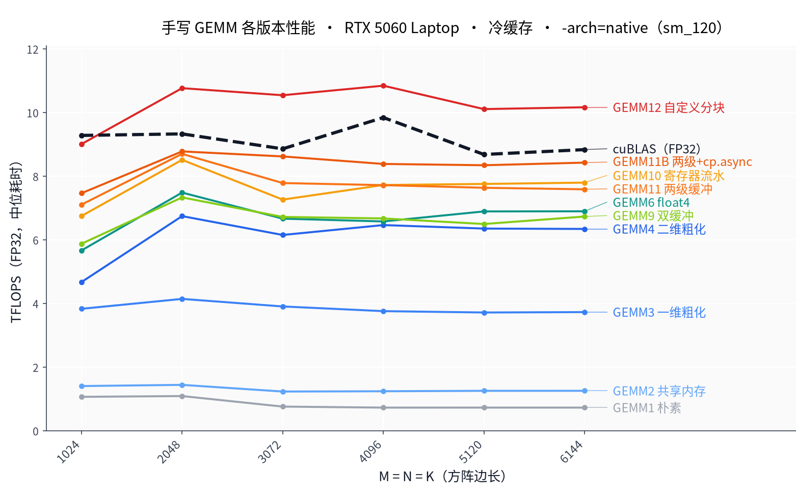

**性能总览（-arch=sm_80）：**

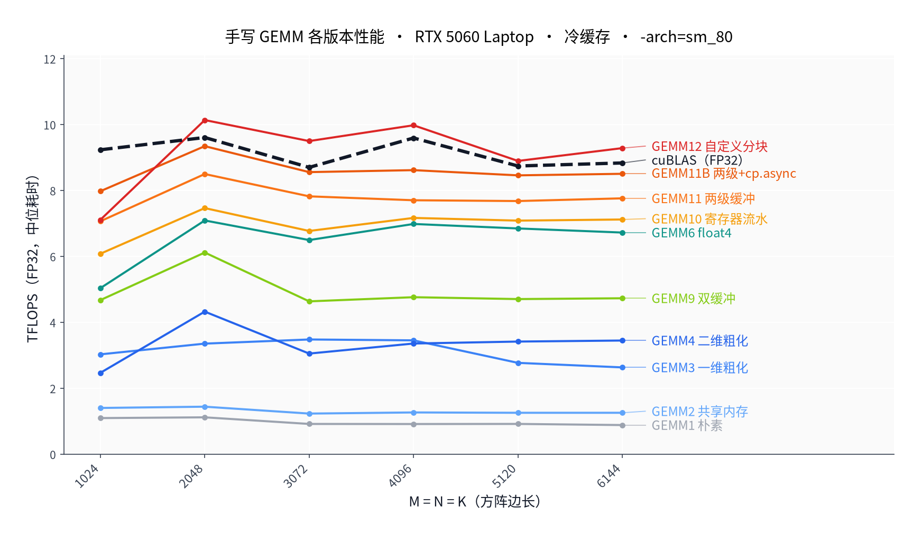

---

## 预备知识

### GPU 的存储层级

CUDA kernel 能用的存储分四层，越往上越快、越小、越私有。所有 GEMM 优化做的事，概括起来就是把数据从下层搬到上层，并在上层反复使用。

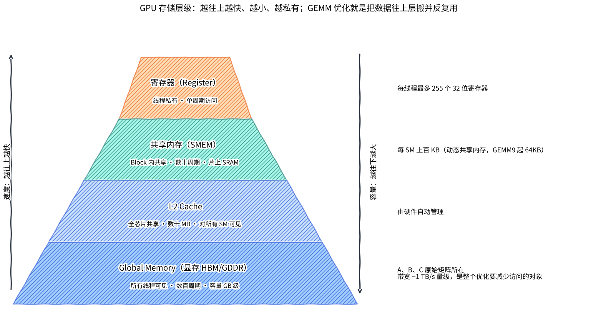

### 线程层级：Grid、Block、Thread

一个 kernel 启动后，GPU 上的线程组织成三级结构。计算 C 矩阵时，Grid 内所有 block 铺满整个 C，每个 block 负责一个 tile，block 内每个线程再负责 tile 中的一个元素/一小块。

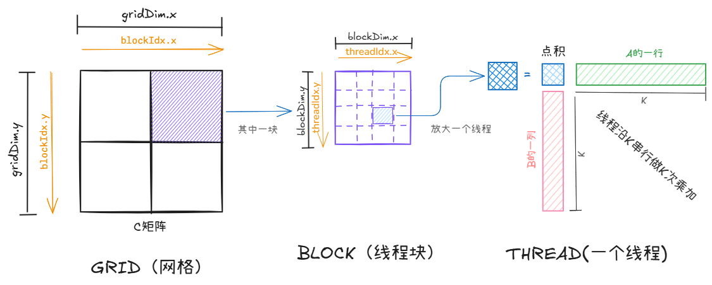

---

## 优化路线逐版本讲解

计算 `C = A @ B`，`A (M,K)`、`B (K,N)`、`C (M,N)` ，均为行主序。

下文代码片段是核心逻辑，完整实现见 GEMM.cu 中对应函数。

### 阶段一：朴素版与它的问题（GEMM1）

一个线程负责一个输出元素 `C[row][col]`，沿 K 串行读取 A 的一行和 B 的一列做点积。

```cpp
__global__ void GEMM1(float* C, const float* A, const float* B, int M, int N, int K) {
    int row = blockIdx.y * blockDim.y + threadIdx.y;
    int col = blockIdx.x * blockDim.x + threadIdx.x;
    if (row < M && col < N) {
        float sum = 0.0f;
        for (int k = 0; k < K; k++)
            sum += A[row * K + k] * B[k * N + col];
        C[row * N + col] = sum;
    }
}
```

一个线程的访问路径：A 沿行读，地址连续；B 沿列读，相邻元素跨 N 个 float，地址不连续。

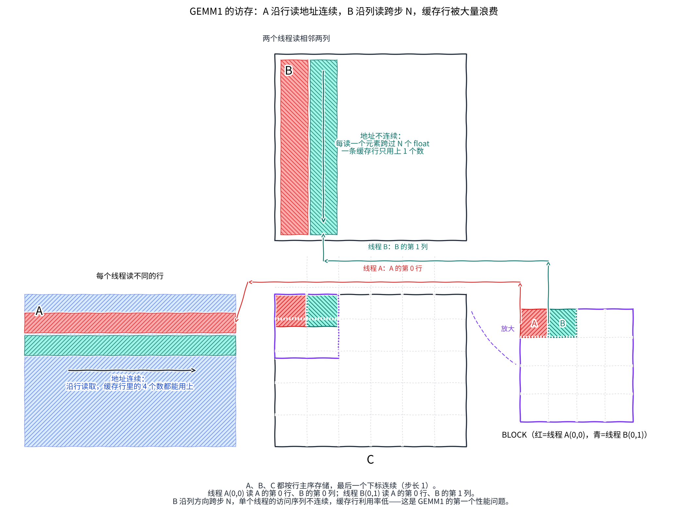

**合并访存（Coalescing）**：一个 warp 32 个线程同时发出访存请求时，如果地址连续，32 个 32 位请求（共 128 字节）会被硬件合并成一条宽事务；如果地址跨步 N，则每条缓存行只用上 1 个数，请求数和流量成倍放大。

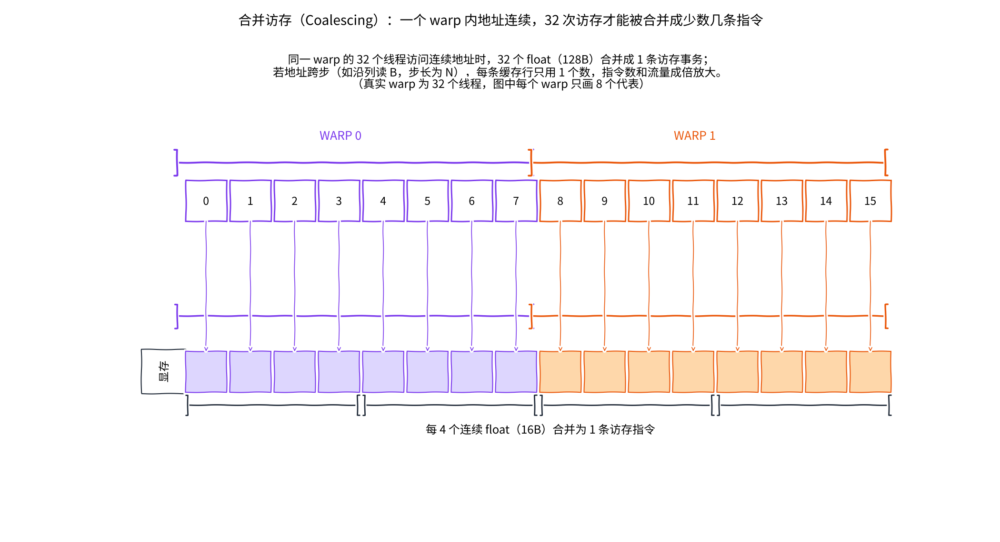

需要区分两个视角：B 沿列跨步 N，**单个线程的访问序列**不连续；但从 warp 视角看，相邻线程的 `col` 相邻、读 B 的同一行，访问 B 的那一条指令本身是连续的。GEMM1 真正的致命伤是算术强度太低——每个结果都要从全局内存读 K 行 A 和 K 列 B，访存量 O(MNK)，计算完全被内存延迟拖住。

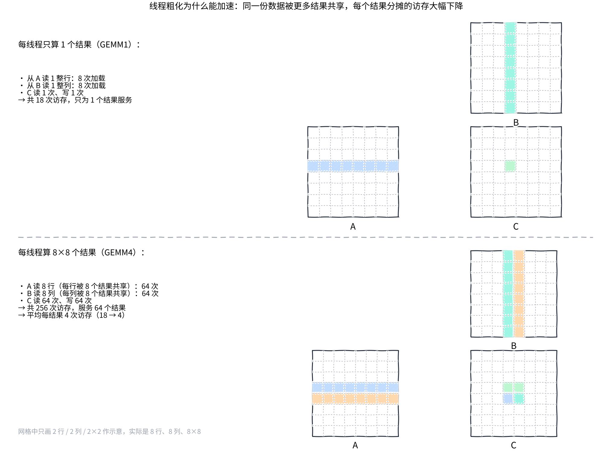

一个线程只算 1 个结果，需要读 A 一行 8 个、B 一列 8 个，共 18 次访存只服务 1 个结果；让一个线程算 8×8 个结果后，256 次访存服务 64 个结果，平均每个结果摊到 4 次访存。同一份数据被更多结果共享，是后续所有优化的主线。

4096 尺寸实测 0.73 TFLOPS，只有 cuBLAS 的 7.4%。

### 阶段二：共享内存分块（GEMM2）

一个 32×32 的输出 tile 里，所有线程合起来只用到 32 行 A 和 32 列 B。先把这两块数据搬到共享内存，块内线程再从共享内存读，A 的每个元素被 32 个线程共用，B 同理，全局访存量降到约 1/32。

```cpp
constexpr int BK = 32, BM = 32, BN = 32;
__shared__ float Ads[BM][BK];
__shared__ float Bds[BK][BN];

for (int tile = 0; tile < K; tile += BK) {
    Ads[ty][tx] = A[row * K + tile + tx];   // 协作加载
    Bds[ty][tx] = B[(tile + ty) * N + col];
    __syncthreads();
    for (int k = 0; k < BK; k++)
        sum += Ads[ty][k] * Bds[k][tx];     // 只从共享内存读
    __syncthreads();
}
```

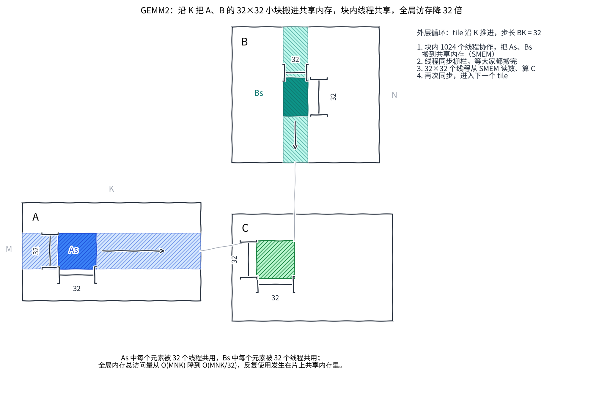

4096 尺寸提升到 1.24 TFLOPS。但性能仍然很低：内层每做 1 次 FMA 要读 2 次共享内存，计算访存比只有 1:2，共享内存读延迟没有被任何计算掩盖。

### 阶段三：线程粗化（GEMM3、GEMM4）

思路是让一个线程算多个输出，读进寄存器的数据被多次复用。

**GEMM3 一维粗化**：每线程沿 M 方向负责 TM=8 个结果，block 扩到 32×16 共 512 线程，覆盖 128×32 的输出 tile。一个 warp 32 个线程恰好覆盖 BN=32 列，每个线程持 8 个累加器。每个内层 k 迭代读 8 个 A、1 个 B，做 8 次 FMA，计算访存比从 1:2 升到 8:9。

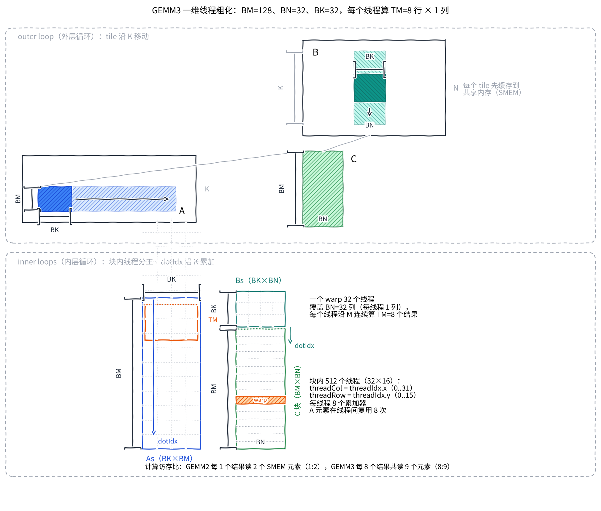

**GEMM4 二维粗化**：N 方向同样复用。每线程负责 8×8 共 64 个结果，block 缩回 16×16 共 256 线程，覆盖 128×128 的 tile。每个 k 迭代读 8 个 A、8 个 B，做 64 次 FMA，计算访存比 64:16。

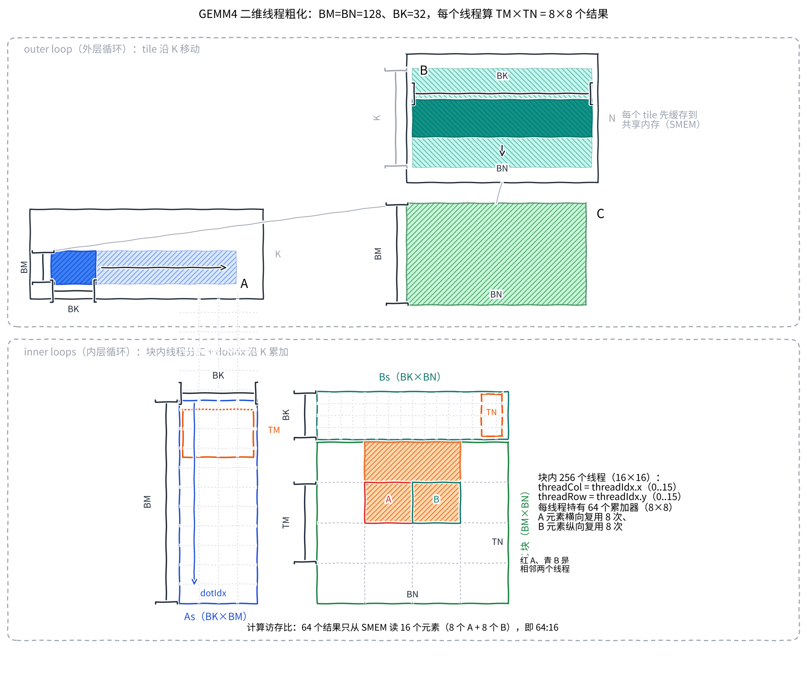

**协作加载**：块内线程把自己铺平成一维，用步长循环把整块 `As`、`Bs` 填满。加载行横跨 BK，warp 内 32 个线程访问连续地址，天然满足合并访存；行与行之间按线程数跨步。

```cpp
for (int i = tid; i < BM * BK; i += blockDim.x * blockDim.y) {
    int m = i / BK;
    int k = i % BK;
    As[m][k] = A[(blockIdx.y * BM + m) * K + tile + k];
}
```

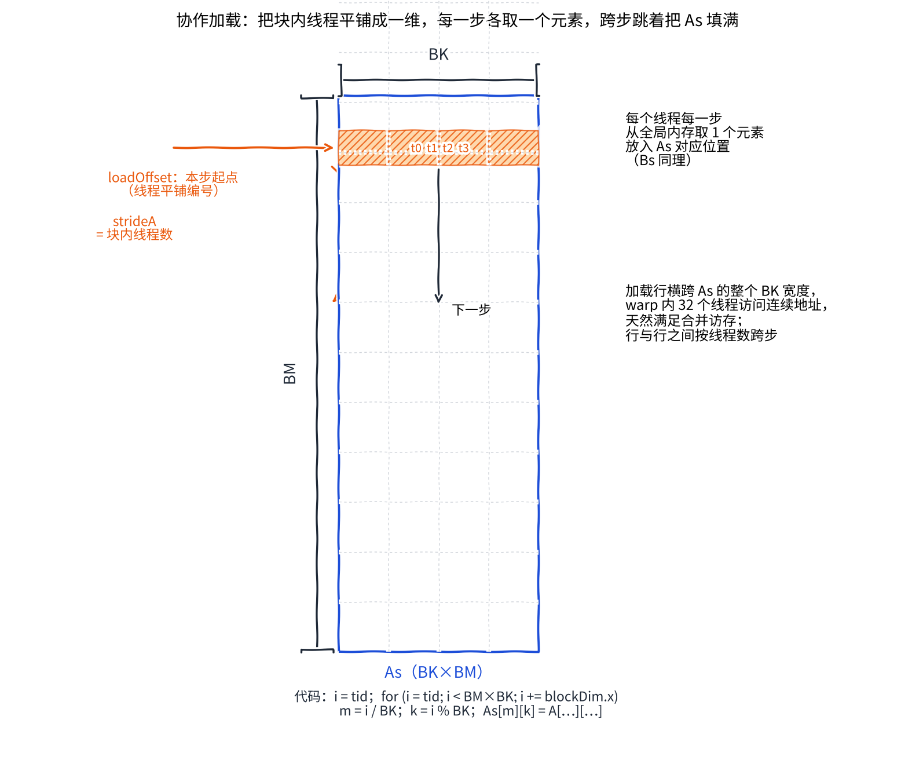

GEMM3、GEMM4 在 4096 尺寸分别为 3.76、6.47 TFLOPS。代价是寄存器：64 个累加器加寻址变量，单线程寄存器接近 100 个，占用率开始下降。

### 三级 Tiling 总览

GEMM4 之后的版本采用统一的三级划分：

- Grid 按 128×128 的 block tile 铺满 C：`grid = (N/128, M/128)`；
- 每个 block 16×16 共 256 个线程，协作计算一个 128×128 的 block tile；
- 每个线程负责一个 8×8 的 thread tile，持有 64 个累加器；
- K 方向每次推进 BK=32。

GEMM12 在此基础上把 thread tile 放大到 16×8（每线程 128 个累加器）、线程数降到 128、BK 收到 16。

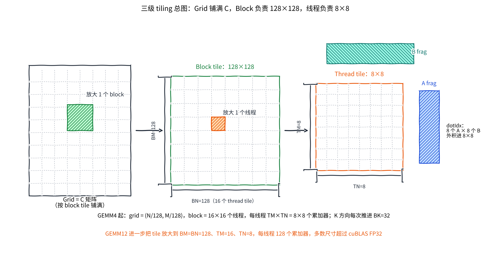

### 三层循环对应三级存储

分块后的 kernel 是三层嵌套循环，每深入一层，数据就向计算单元靠近一级：

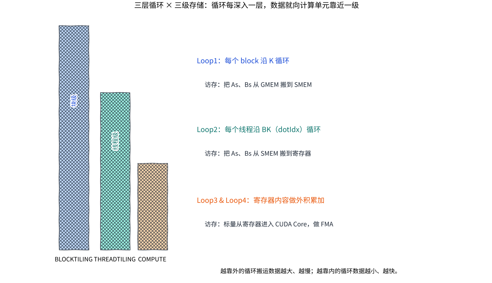

1. **Loop 1**：每个 block 沿 K 循环，把 `As`、`Bs` 从全局内存搬到共享内存；
2. **Loop 2**：每个线程沿 BK（dotIdx）循环，把 `As`、`Bs` 从共享内存搬到寄存器；
3. **Loop 3 & 4**：寄存器里的标量进入 CUDA Core 做外积累加（FMA）。

### 阶段四：寄存器复用（GEMM5）

GEMM4 的内层循环里，同一个 B 值在 i 循环中被重复读了 8 次。把 B 的一行先读进 `b_val[TN]` 寄存器，后续 FMA 全部用寄存器，共享内存访问次数减半。

```cpp
for (int k = 0; k < BK; k++) {
    float b_val[TN];
    for (int j = 0; j < TN; j++)
        b_val[j] = Bds[k][tx * TN + j];    // 先读进寄存器
    for (int i = 0; i < TM; i++) {
        float a_val = Ads[ty * TM + i][k];
        for (int j = 0; j < TN; j++)
            val[i][j] += a_val * b_val[j]; // 后续全部用寄存器
    }
}
```

每一步 dotIdx 把 A 的一列（regM）和 B 的一行（regN）读进寄存器，做一次外积，累加进 8×8 的结果矩阵。下图示意 2×2 粗化、4 步的过程。

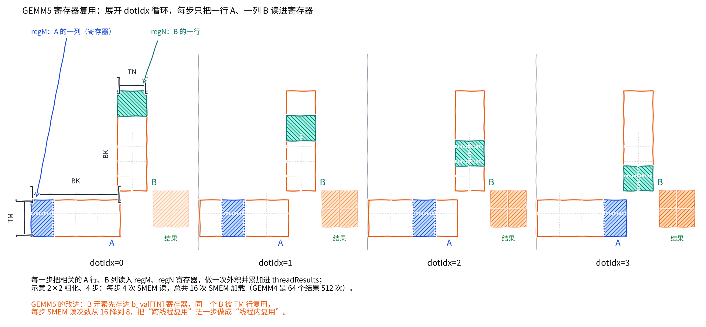

GEMM2 是跨线程复用（共享内存），GEMM5 是线程内复用（寄存器），本质都是把数据往快层搬。本机性能与 GEMM4 基本持平（6.55 vs 6.47 TFLOPS），因为此时瓶颈已转向全局访存的指令数，但这一版确定了后续所有 kernel 的内层结构。

### 阶段五：float4 向量化（GEMM6、GEMM6B）

此前全局到共享的搬运按单个 float 进行，一条 LDG 指令搬 4 字节。`float4` 一条指令搬 16 字节（LDG.128），同样数据的加载指令数降到 1/4。

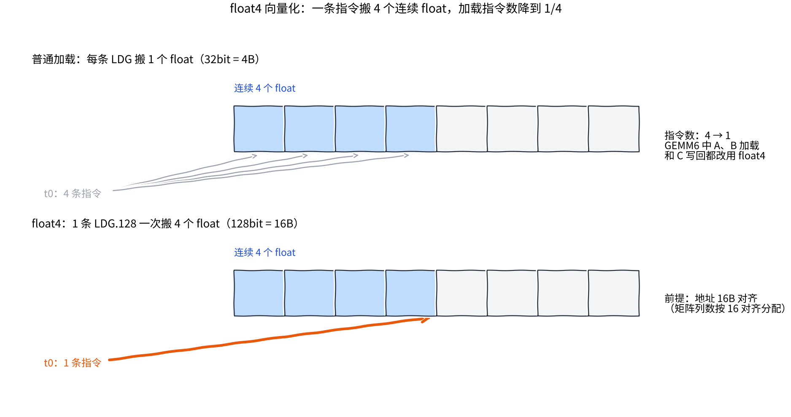

```cpp
// 全局 → 共享：一条 LDG.128 搬 4 个 float
for (int i = tid; i < BM * (BK / 4); i += blockDim.x) {
    int m = i / (BK / 4), k = (i % (BK / 4)) * 4;
    *(float4*)&Ads[m][k] = *(const float4*)&A[(blockIdx.y * BM + m) * K + tile + k];
}
```

前提是地址 16 字节对齐、K 与 N 能被 4 整除（矩阵按 16 对齐分配）。GEMM6 的 A、B 加载和 C 写回都用 float4。GEMM6B 进一步把计算阶段读 Bds 也改为 float4（Ads 沿行跨 BK 不连续，无法向量化），再带来约 2%~12% 收益。4096 尺寸 GEMM6 为 6.58 TFLOPS、GEMM6B 为 7.40 TFLOPS。
```cpp
// GEMM6B 新增：计算阶段读 Bds 也改成 float4，LDS 指令数压到 1/4
// （Ads 沿行跨 BK 不连续，无法向量化，保持标量读）
for (int k = 0; k < BK; k++) {
    float4 b_val4[TN / 4];
    for (int j = 0; j < TN; j += 4)
        b_val4[j / 4] = *(const float4*)&Bds[k][tx * TN + j];   // 4 个 float 一次读
    for (int i = 0; i < TM; i++) {
        float a_val = Ads[ty * TM + i][k];
        for (int j = 0; j < TN; j += 4) {
            val[i][j+0] += a_val * b_val4[j/4].x;
            val[i][j+1] += a_val * b_val4[j/4].y;
            val[i][j+2] += a_val * b_val4[j/4].z;
            val[i][j+3] += a_val * b_val4[j/4].w;
        }
    }
}
```


### 阶段六：共享内存 Bank 冲突（GEMM7、GEMM7B、GEMM8）

共享内存分成 32 个 bank，每周期每个 bank 只能服务一个地址。warp 内的多个线程访问同一个 bank，硬件就把请求串行化，即 bank conflict。

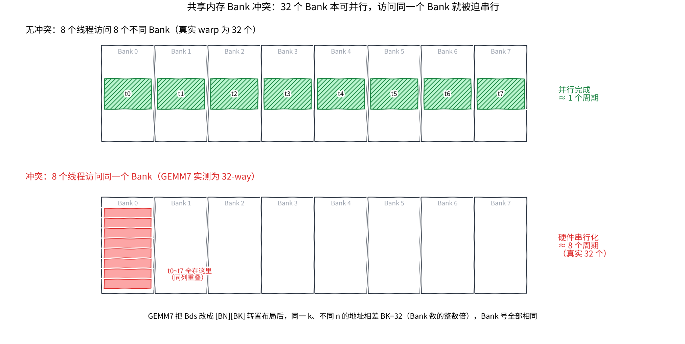

**GEMM7 是刻意保留的反面教材**。为了让 A 侧也能 float4 读取，把 `Bds` 从 `[BK][BN]` 改成 `[BN][BK]` 转置布局。转置后同一列（k 相同、n 不同）的地址相差 BK=32，恰好是 bank 数的整数倍，warp 内 32 个线程的访问全部落到同一个 bank，产生 32-way 冲突。NCU 实测计算吞吐利用率掉到 20.7%，4096 耗时 42.32 ms，比 GEMM6 慢一倍。
```cpp
// GEMM7 的布局改动：B 转置成 [BN][BK]，沿 k 连续，计算阶段才能用 float4 读
__shared__ float Bds[BN][BK];   // 不再是 [BK][BN]

// 加载：从全局读连续 n 方向的 float4，转置写入共享内存
for (int i = tid; i < BK * (BN / 4); i += blockDim.x * blockDim.y) {
    int k = i / (BN / 4), n = (i % (BN / 4)) * 4;
    float4 v = *(const float4*)&B[(tile + k) * N + blockIdx.x * BN + n];
    Bds[n + 0][k] = v.x;  Bds[n + 1][k] = v.y;
    Bds[n + 2][k] = v.z;  Bds[n + 3][k] = v.w;
}

// 计算：所有线程沿同一个 k 读 Bds[.][k]，落在同一 bank → 32-way 冲突
for (int k = 0; k < BK; k += 4) {
    float4 b_val[TN];
    for (int j = 0; j < TN; j++)
        b_val[j] = *(const float4*)&Bds[tx * TN + j][k];
    ...
}
```


**GEMM7B** 用 `k_offset = tid*4` 循环移位，让不同线程从不同的 k 开始访问，把计算阶段的冲突降到 2-way；但加载阶段的 32-way 转置写入冲突没有处理，性能回到 6.46 TFLOPS，仍不如 GEMM6。
```cpp
// GEMM7B 与 GEMM7 唯一区别：k 的起点按线程编号旋转
// 线程 tid 从 k = tid*4 开始，绕一圈回到起点，warp 内 32 个线程的起始 k 各不相同
for (int k_offset = tid * 4; k_offset < BK + tid * 4; k_offset += 4) {
    int k = k_offset % BK;   // 访问被打散到不同 bank
    ...
}
```


**GEMM8 用 XOR Swizzle 一次性解决两处冲突**。不改变存储大小，只把行号的几个位异或进列地址，让同一列在不同行落到不同 bank；float4 粒度保持，对齐不受影响。

```cpp
// swizzle(n,k) = ((k>>2) ^ ((n>>3) & 7)) << 2 | (k & 3)
auto swizzle = [](int n, int k) {
    int c   = k / 4;              // 第几个 float4 块
    int off = k % 4;              // 块内偏移
    int sc  = c ^ ((n / 8) % 8);  // 行号特征混入列块号
    return sc * 4 + off;
};
```

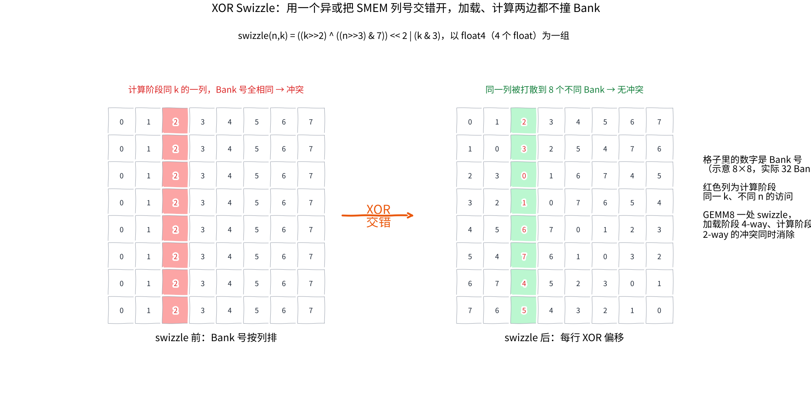

加载和计算两处套同一个映射，冲突从 32/16 路降到 4/2 路。4096 尺寸 8.45 TFLOPS，比 GEMM6B 高 14%。后续 GEMM9–GEMM12 全部沿用 swizzle 布局。

### 阶段七：双缓冲与软件流水（GEMM9、GEMM9B、GEMM10、GEMM10B）

分块后的每个 tile 要经历"加载 → 同步 → 计算 → 同步"，加载和计算严格串行。流水线的目标是让加载下一块和计算当前块重叠。

**GEMM9 朴素双缓冲**。开两份共享内存 `[2][BM][BK]`，计算当前块的同时预取下一块，交替使用（ping-pong）。共享内存翻倍到 64 KB，需要用 `cudaFuncSetAttribute` 提高单 block 动态共享内存上限。
```cpp
// GEMM9：动态共享内存 64 KB，开两份 buffer（ping-pong）
extern __shared__ char smem[];
auto& Ads = *reinterpret_cast<float (*)[2][BM][BK]>(smem);
auto& Bds = *reinterpret_cast<float (*)[2][BN][BK]>(smem + 2 * BM * BK * sizeof(float));
// launch 前必须提高单 block 动态共享内存上限
cudaFuncSetAttribute(GEMM9, cudaFuncAttributeMaxDynamicSharedMemorySize, 64 * 1024);

// 主循环：先把下一 tile 预取进 next_buf，再计算当前 buf
for (int tile = 0; tile < K; tile += BK) {
    if (next_tile < K) {
        // LDG + 转置 STS 写进 Ads[next_buf] / Bds[next_buf]
    }
    /* 计算 Ads[buf] / Bds[buf] 的 FMA */
    __syncthreads();
    buf = next_buf;   // 切换 buffer
}
```


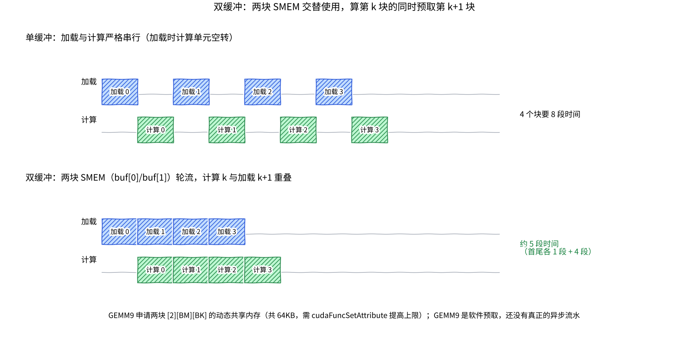

但这一版实测 6.68 TFLOPS，没有比 GEMM8 快。原因是加载下一 tile 的代码整段排在计算前面，LDG 一次性发完、STS 全部写完才进入计算，编译器找不到交错调度点，双缓冲开了却没有形成流水。这是"写了双缓冲不等于有流水线"的典型案例。

**GEMM9B 用 cp.async**。cp.async 是 sm_80 引入的异步拷贝指令，由 DMA 引擎把数据从全局内存直接搬进共享内存，不经过寄存器、不占用线程发射槽；用 `commit_group` / `wait_group` 管理进度。

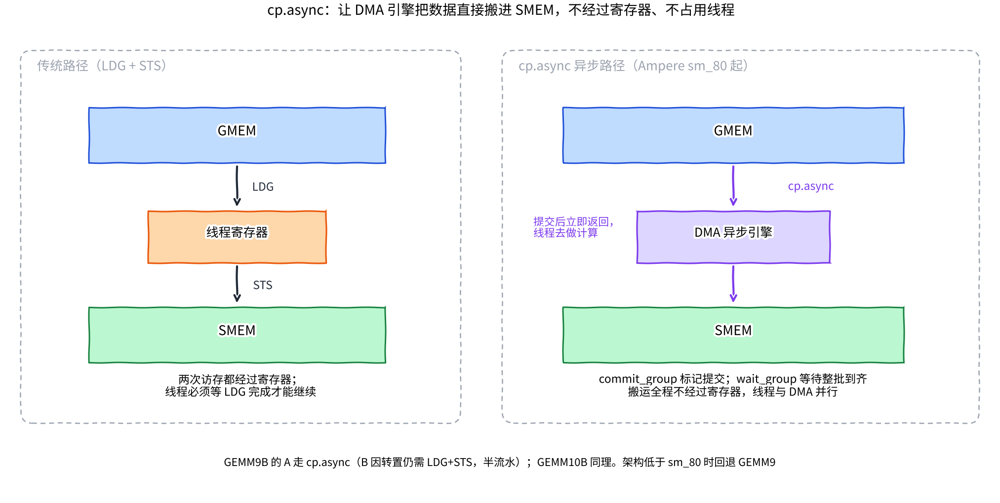

```cpp
asm volatile("cp.async.ca.shared.global [%0], [%1], 16;"
    : : "l"(&Ads[b][m][k]), "l"(&A[...]) : "memory");
asm volatile("cp.async.commit_group;" ::: "memory");
asm volatile("cp.async.wait_group 1;" ::: "memory");
```

由于 B 需要转置加 swizzle，cp.async 只能做直线拷贝，本版只有 A 侧真正异步（半流水），性能 6.72 TFLOPS。架构低于 sm_80 时通过 `#if __CUDA_ARCH__ >= 800` 自动回退到软件加载。

**GEMM10 寄存器软件流水**。不依赖新硬件，靠指令调度让加载与计算真正重叠。把加载拆成两个动作，中间插入计算：

```cpp
// 1. issue_load：只发 LDG 到预取寄存器，不等待返回，warp 继续往下走
// 2. 计算当前 tile 的全部 FMA（LDG 的数百周期延迟被这段计算盖住）
// 3. commit_store：把预取寄存器 STS 落进共享内存，此刻才隐式等待未到的数据
if (next_tile < K) issue_load(a_next, b_next, next_tile);
/* ... 计算 current tile ... */
if (next_tile < K) commit_store(a_next, b_next, next_buf);
```

利用的是硬件 scoreboard 机制：写寄存器不阻塞，只有读它的时候才等待。A、B 两路都走这条路，是全流水；每线程多持有 8 个 float4 预取寄存器。

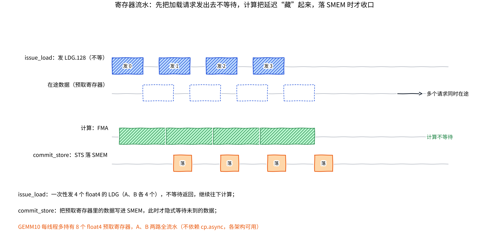

4096 尺寸 native 下 7.73 TFLOPS，比 GEMM9 快 14%；`-arch=sm_80` 下快 34%，显式调度的优势被放大。

**GEMM10B 混合流水**：A 不需要转置，改用 cp.async 直拷，省 4 个 float4 预取寄存器；B 保留寄存器预取。4096 尺寸 8.17 TFLOPS，寄存器从 155 降到 141。
```cpp
#if __CUDA_ARCH__ >= 800
// A：发 cp.async 直拷（DMA 后台搬运，不占寄存器）
issue_a_copy(next_buf, next_tile);
// B：仍走 LDG 到预取寄存器（需要转置+swizzle，cp.async 搬不了）
issue_b_load(next_tile);
asm volatile("cp.async.commit_group;" ::: "memory");
asm volatile("cp.async.wait_group 1;" ::: "memory");  // 只等 current 到位，next 继续飞
/* ... 计算 current（B 的 LDG 延迟被 FMA 盖住）... */
commit_b_store(next_buf);   // B 的转置+swizzle 落共享
#endif
```


### 阶段八：两级流水线（GEMM11、GEMM11B）

GEMM10 只把"全局→共享"做成流水，"共享→寄存器"仍然与 FMA 串行，BK=32 时共享内存读延迟累积 32 次。GEMM11 把寄存器 fragment 也开双缓冲，流水线扩成三级：

```
全局内存 → 共享内存（第一级双缓冲）→ 寄存器 fragment（第二级双缓冲）→ FMA
```

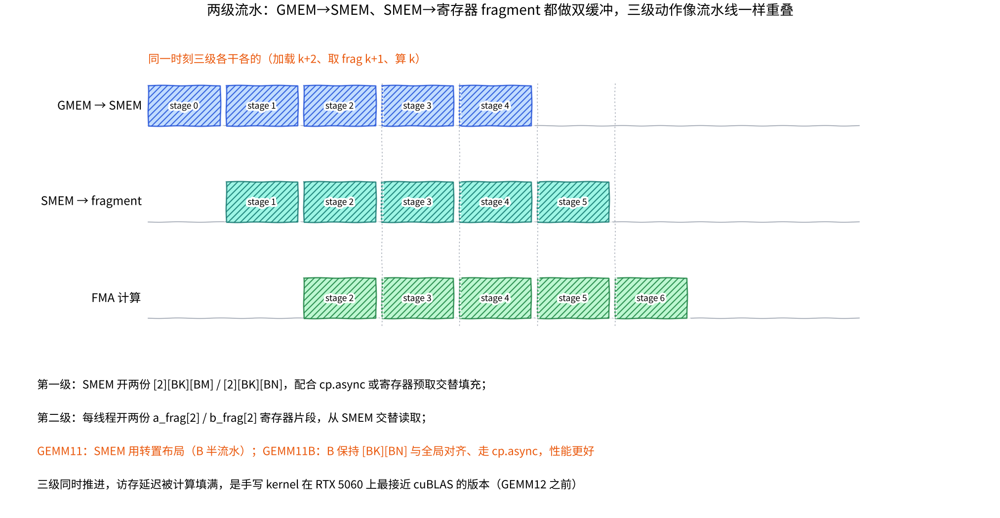

共享内存布局改为转置的 `[BK][BM]` / `[BK][BN]`，让内层 fragment 固定 k、沿 M/N 方向连续读，支持 float4。每线程持 `a_frag[2]`、`b_frag[2]` 两份寄存器片段，边预取下一排边做当前排的 FMA。

```cpp
float a_frag[2][TM], b_frag[2][TN];
for (int bk = 0; bk < BK - 1; bk++) {
    issue_frag_load(buf, bk);   // 预取 bk+1 排，不等
    commit_frag_fma(bk);        // 用 bk 排做 FMA，消费上一轮预取
}
```

GEMM11B 中 B 的共享内存形状 `[BK][BN]` 与全局行主序完全对齐，不需要转置，B 路也换成 cp.async（`wait_group 0`），A 路保留软件转置。4096 尺寸 GEMM11 / GEMM11B 为 7.72 / 8.39 TFLOPS，NCU 显存吞吐从 46% 升到 83.5%。
```cpp
#if __CUDA_ARCH__ >= 800
// B 布局与全局对齐、无转置 → 整条 B 路交给 DMA，代码只有 4 行
auto issue_b_copy = [&](int b, int tile) {
    for (int i = 0; i < 4; i++) {
        int idx = tid + i * 256;
        int k = idx / (BN / 4), n = (idx % (BN / 4)) * 4;
        asm volatile("cp.async.ca.shared.global [%0], [%1], 16;"
            : : "l"(&Bds[b][k][n]),
                "l"(&B[(tile + k) * N + blockIdx.x * BN + n]) : "memory");
    }
};
issue_a_load(next_tile);                    // A：LDG 中转（需转置）
issue_b_copy(next_buf, next_tile);          // B：cp.async 直拷
asm volatile("cp.async.commit_group;" ::: "memory");
/* ... 内层 fragment 流水做完整块 FMA ... */
asm volatile("cp.async.wait_group 0;" ::: "memory");  // B 全部到位再落 A
commit_a_store(next_buf);
#endif
```


### 阶段九：分块形状调参（GEMM12）

在本机上重新选择分块形状：BK 32→16、TM 8→16、TN 保持 8、线程 256→128。

```cpp
constexpr int BK = 16, BM = 128, BN = 128, TM = 16, TN = 8;
constexpr int BLOCK_THREADS = 128;   // dim3 block(16, 8)
constexpr int A_ROUNDS = BK * BM / BLOCK_THREADS / 4;  // 每线程 4 个 float4
constexpr int B_ROUNDS = BK * BN / BLOCK_THREADS / 4;

// 主循环：三级流水同时推进（128 线程，BK=16 只有 15 次内层迭代）
for (int tile = 0; tile < K; tile += BK) {
    if (next_tile < K) {
        issue_a_load(next_tile);            // A：LDG 到 ldg_a（软件转置需要）
        issue_b_copy(next_buf, next_tile);  // B：cp.async 直拷
        asm volatile("cp.async.commit_group;" ::: "memory");
    }
    for (int bk = 0; bk < BK - 1; bk++) {   // 内层 fragment 双缓冲
        issue_frag_load(buf, bk);           // 预取 bk+1 排（共享 → 寄存器）
        commit_frag_fma(bk);                // 算 bk 排（寄存器 FMA）
    }
    commit_frag_fma(BK - 1);
    if (next_tile < K) {
        asm volatile("cp.async.wait_group 0;" ::: "memory"); // B 全部到位
        commit_a_store(next_buf);           // A 转置落共享
        __syncthreads();
        /* 预取 next 的 fragment 到 a_frag[0] / b_frag[0] */
    }
    buf = next_buf;
}
```

两个方向的调整：

1. **K 分块收窄**：双缓冲共享内存从 64 KB 减半到 32 KB；K 循环次数翻倍，流水步长更细，延迟隐藏更充分。
2. **计算粒度放大**：每线程从 64 个累加器增到 128 个（16×8 细长 tile），线程数减半，单线程指令级并行（ILP）更强，编译器更容易排满流水线。

代价是每线程 247 个寄存器（NCU 实测），占用率降到约 2 block/SM——用占用率换单线程 ILP。GEMM12 同时用上两级流水、A 侧软件转置预取、B 侧 cp.async、float4 与 swizzle，是全部优化的集大成版本，4096 尺寸 10.85 TFLOPS，超过 cuBLAS 的 9.85 TFLOPS。

### 工业基准：cuBLAS / cuBLASLt

cuBLAS 默认列主序。行主序的 `C(M,N) = A(M,K) · B(K,N)` 在列主序视角下等价于 `C(N,M) = B(N,K) · A(K,M)`，调用时指针和 M、N 都要对调：

```cpp
cublasSgemm(handle, CUBLAS_OP_N, CUBLAS_OP_N,
    N, M, K, &alpha, B, N, A, K, &beta, C, N);
```

cuBLASLt 是可配置层，通过 matmul desc、layout、heuristic 三个描述符让库自行选择 kernel，并可使用 workspace。两者在本机 FP32 性能基本一致（4096 为 9.85 / 9.50 TFLOPS），作为所有手写 kernel 的性能分母。

### 优化路线总览

| 阶段 | 版本 | 核心手段 | 关键配置 | 解决的瓶颈 |
| --- | --- | --- | --- | --- |
| 基线 | GEMM1 | 朴素 GPU 移植 | block 32×32，一线程一元素 | — |
| 数据复用 | GEMM2 | 共享内存分块 | BM=BN=BK=32 | 全局访存量 O(MNK) |
| 线程粗化 | GEMM3 | 一维粗化 | TM=8，block 32×16 | 计算访存比 1:2 |
| 线程粗化 | GEMM4 | 二维粗化 | TM=TN=8，block 16×16 | N 方向未复用 |
| 寄存器 | GEMM5 | B 先读进寄存器 | 同上 | SMEM 元素被重复读 8 次 |
| 向量化 | GEMM6 | 全局访存 float4 | 128-bit LDG/STG | 访存指令数过多 |
| 向量化 | GEMM6B | 计算阶段 float4 | 128-bit LDS | 计算阶段 LDS 指令数 |
| Bank 冲突 | GEMM7 | 转置布局反例 | Bds[BN][BK] | 刻意制造的反面教材 |
| Bank 冲突 | GEMM7B | k_offset 循环移位 | 同上 | 计算阶段冲突 |
| Bank 冲突 | GEMM8 | XOR Swizzle | float4 粒度 | 加载+计算两处冲突 |
| 流水线 | GEMM9 | 朴素双缓冲 | 动态 SMEM 64 KB | 加载与计算串行 |
| 流水线 | GEMM9B | cp.async 双缓冲 | A 侧 DMA，B 侧同步 | 软件预取占发射槽 |
| 流水线 | GEMM10 | 寄存器软件流水 | issue/commit 拆分 | 双缓冲没有形成流水 |
| 流水线 | GEMM10B | cp.async A + 寄存器预取 B | 同上 | A 侧预取白占寄存器 |
| 两级流水 | GEMM11 | SMEM + fragment 双缓冲 | 转置布局 [BK][BM] | SMEM→寄存器读延迟 |
| 两级流水 | GEMM11B | B 侧改 cp.async | wait_group 0 | B 侧加载指令可省 |
| 形状调优 | GEMM12 | 自定义分块 | BK=16, TM=16, TN=8, 128 线程 | 分块/寄存器/占用率平衡 |
| 基准 | GEMM13/14 | cuBLAS / cuBLASLt | 库自动选 kernel | 工业上限对照 |

---

## 编译与运行

依赖：CUDA Toolkit 11.0+（`cp.async` 与 sm_120 需要 CUDA 12.x）、cuBLAS、cuBLASLt；重绘图表需要 Python 3、matplotlib、numpy。

```bash
# 本机原生架构（测试机为 Blackwell sm_120）
nvcc -O3 --use_fast_math -Xcompiler -fopenmp -arch=native GEMM.cu -o GEMM -lcublas -lcublasLt

# 指定 Ampere 目标，用于对比编译目标对性能的影响
nvcc -O3 --use_fast_math -Xcompiler -fopenmp -arch=sm_80 GEMM.cu -o GEMM -lcublas -lcublasLt

# 多架构兼容编译
nvcc -O3 --use_fast_math -Xcompiler -fopenmp \
        -gencode arch=compute_75,code=sm_75 \
        -gencode arch=compute_80,code=sm_80 \
        -gencode arch=compute_90,code=sm_90 \
        -gencode arch=compute_120,code=sm_120 \
        GEMM.cu -o GEMM -lcublas -lcublasLt
```

```bash
./GEMM          # 热缓存：不清 L2，矩阵在缓存中重复使用
./GEMM cold     # 冷缓存：每次计时前冲刷 L2，本文所有性能数据均为此模式
./GEMM profile  # 固定 4096，跳过校验，配合 NCU / Nsight Systems 采集
```

每个尺寸先预热 10 轮（每个 kernel 各 10 次，覆盖 cuBLAS 初始化），再做一次 CPU 参考结果校验（OpenMP 并行三重循环，最大误差阈值 1e-2），然后开始计时。

重绘图表：

```bash
python plot.py                   # 5 张数据图：性能总览×2、cuBLAS 占比、NCU 吞吐、寄存器
python scripts/siboehm_style.py  # 19 张原理示意图（PNG + SVG）
```

## 基准测试方法

- **计时方式**：CUDA Event 记录 kernel 时长，只统计 GPU 执行时间，不含数据准备。
- **交替采样**：5 轮测量，每轮把 19 个 kernel 依次跑一遍；偶数轮正序 1→19，奇数轮倒序 19→1，把 GPU 时钟与温度漂移平均分摊给所有 kernel。
- **样本数量**：GEMM1、GEMM2 每轮 4 次共 20 个样本（过慢，避免总时间过长），其余每轮 20 次共 100 个样本；同时输出平均值与中位数，图表统一用中位数。
- **冷缓存**：`./GEMM cold` 在每个样本前启动一个 kernel，向 100 MB 缓冲区写数据冲刷 L2，迫使 A、B 从显存重新加载。
- **正确性**：每个 kernel 与 CPU 参考实现逐元素比对，最大误差超过 1e-2 即退出。
- **TFLOPS 公式**：`2·M·N·K / 中位耗时(ms) / 1e9`（FMA 计为 2 次浮点运算）。
- **尺寸序列**：1024、2048、3072、4096、5120、6144（方阵）。

完整原始输出见 [test/benchmark_native.txt](test/benchmark_native.txt) 和 [test/benchmark_sm80.txt](test/benchmark_sm80.txt)，结构化数据见 [test/benchmark.csv](test/benchmark.csv)。

复现 NCU 数据（profile 模式固定 4096，2 轮预热共 38 次启动后开始采集）：

```bash
nvcc -O3 -lineinfo --use_fast_math -Xcompiler -fopenmp -arch=native GEMM.cu -o GEMM -lcublas -lcublasLt
ncu --set full --cache-control all --launch-skip 38 --launch-count 19 -o GEMM_profile ./GEMM profile
```

## Nsight Compute 微结构分析

M=N=K=4096、NCU 锁定时钟下的计算与显存吞吐利用率（锁定时钟后绝对耗时高于基准测试，只看利用率和相对关系）：

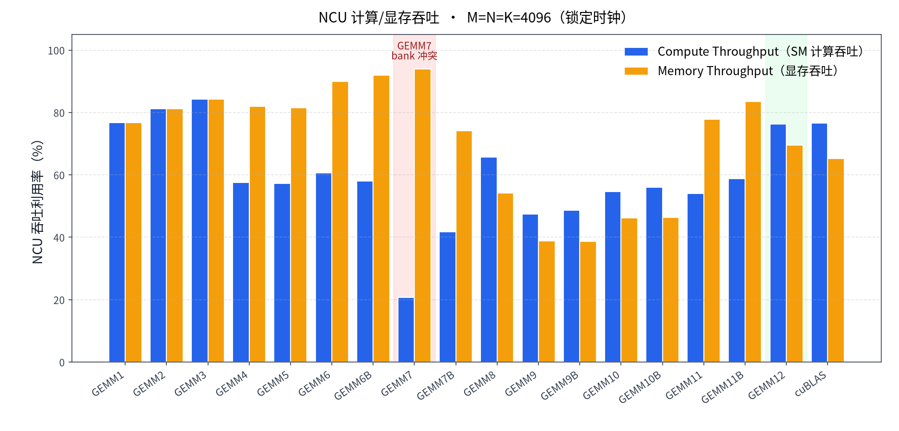

- **GEMM7 计算吞吐仅 20.7%、显存吞吐 94%**：SM 基本不计算，时间全耗在 bank 冲突的共享内存排队上，和代码层面的分析吻合。
- **GEMM9/9B 显存吞吐只有 38% 左右**：双缓冲没有形成流水，加载单元大量闲置，印证"双缓冲不等于流水线"。
- **GEMM12 计算吞吐 76.3%**，与 cuBLAS kernel 的 76.6% 处于同一水平，是全部手写版本中最高的一档。

寄存器占用随优化手段的演进：

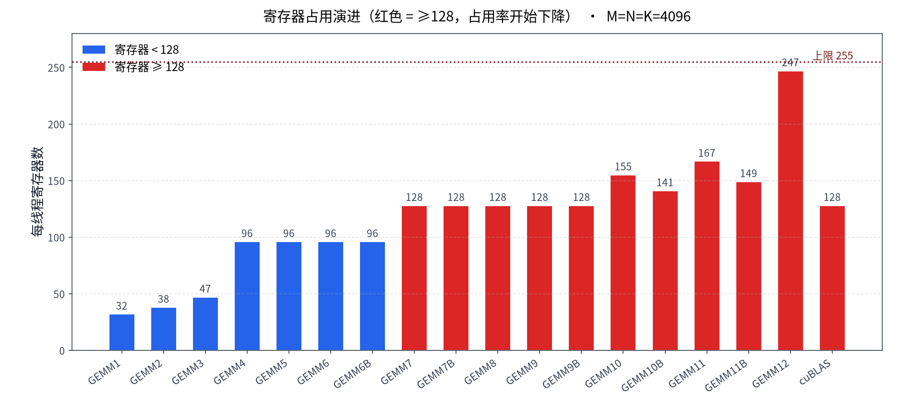

寄存器从 GEMM1 的 32 个涨到 GEMM12 的 247 个。二维粗化（96）、swizzle 与双缓冲（128）、两级流水（149–167）、细长 tile（247）是四次明显跳变。GEMM 优化的核心权衡在这张图上很直观：**用寄存器换计算访存比和 ILP，用占用率换单线程吞吐**。

## 4096 尺寸完整性能表

native、冷缓存、中位耗时。主性能图只收录 11 个代表性版本，这里列出全部 19 个。

| 版本 | 名称 | 中位耗时 (ms) | TFLOPS | 占 cuBLAS |
| --- | --- | ---: | ---: | ---: |
| GEMM1 | 朴素移植 | 188.49 | 0.73 | 7.4% |
| GEMM2 | 共享内存分块 | 110.52 | 1.24 | 12.6% |
| GEMM3 | 一维线程粗化 | 36.54 | 3.76 | 38.2% |
| GEMM4 | 二维线程粗化 | 21.25 | 6.47 | 65.7% |
| GEMM5 | 寄存器复用 | 21.00 | 6.55 | 66.5% |
| GEMM6 | float4 访存向量化 | 20.88 | 6.58 | 66.8% |
| GEMM6B | float4 计算向量化 | 18.58 | 7.40 | 75.1% |
| GEMM7 | bank 冲突反例 | 42.32 | 3.25 | 33.0% |
| GEMM7B | k_offset 旋转 | 21.29 | 6.46 | 65.6% |
| GEMM8 | XOR Swizzle | 16.27 | 8.45 | 85.8% |
| GEMM9 | 朴素双缓冲 | 20.59 | 6.68 | 67.8% |
| GEMM9B | cp.async 双缓冲 | 20.46 | 6.72 | 68.2% |
| GEMM10 | 寄存器流水 | 17.79 | 7.73 | 78.5% |
| GEMM10B | 混合流水 | 16.82 | 8.17 | 83.0% |
| GEMM11 | 两级双缓冲 | 17.80 | 7.72 | 78.4% |
| GEMM11B | 两级 + cp.async | 16.39 | 8.39 | 85.2% |
| GEMM12 | 自定义分块 | 12.67 | 10.85 | 110.2% |
| GEMM13 | cuBLAS (FP32) | 13.96 | 9.85 | 100.0% |
| GEMM14 | cuBLASLt (FP32) | 14.46 | 9.50 | 96.5% |

4096 尺寸两种编译目标的对比（占 cuBLAS 百分比）：

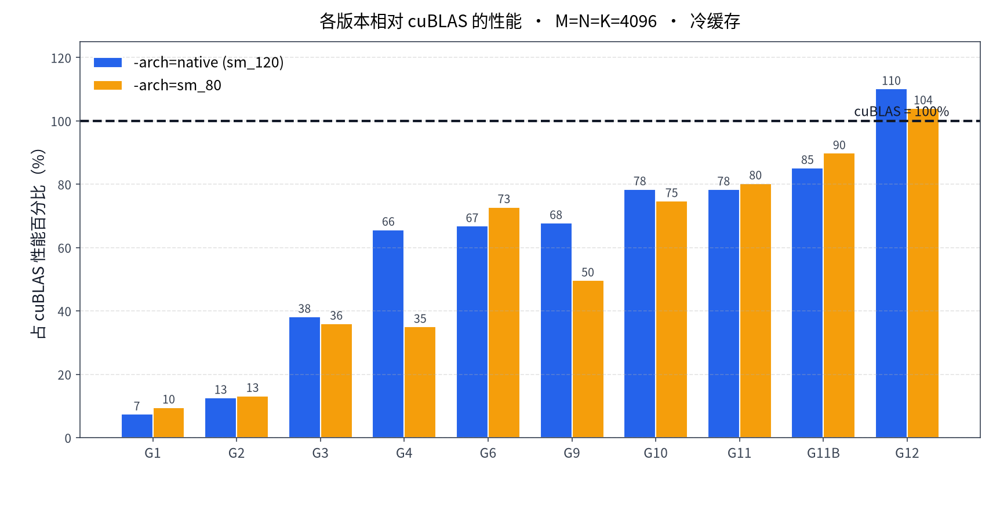

## 编译目标：native 与 sm_80 的差异

同一台机器、同一份代码，只切换编译目标（sm_120 原生与 sm_80 前向兼容 PTX），性能差异高度依赖 kernel 的写法：

- **依赖编译器调度的版本（GEMM4、GEMM5、GEMM9）**：sm_80 下明显变慢，GEMM3/GEMM4 在 3072 尺寸慢近一倍，GEMM9 慢约 40%。指令调度的自由度留给了编译器，不同后端的调度差异被直接放大。
- **显式向量化 / cp.async / 手工流水版本（GEMM6、GEMM10、GEMM11B、GEMM12）**：差异收敛到 ±10%；GEMM11B 在中大尺寸下 sm_80 反而快 1%~3%。
- **最朴素的 GEMM1/GEMM2 和库基准几乎不受影响**。

编译目标改变的是编译器的指令调度和寄存器分配结果，不是硬件本身。写法越固定（显式 float4、内联 PTX、手工 issue/commit）的 kernel，跨编译目标越稳定；生产环境应始终针对部署架构（`-arch=native` 或明确的 `sm_xx`）编译。

## 文件结构

```
GEMM/
├── GEMM.cu                      # 19 个版本：17 个手写 kernel + cuBLAS/cuBLASLt + 基准测试框架
├── plot.py                      # 数据图脚本：性能总览、cuBLAS 占比、NCU 吞吐与寄存器
├── scripts/
│   └── siboehm_style.py         # 19 张原理示意图的绘图脚本
├── images/                      # 全部图表（PNG 位图 + SVG 矢量图，README 引用 PNG）
├── test/
│   ├── benchmark_native.txt     # -arch=native 完整原始输出（19 版本 × 6 尺寸）
│   ├── benchmark_sm80.txt       # -arch=sm_80 完整原始输出
│   └── benchmark.csv            # 11 个主版本的结构化数据（plot.py 生成）
├── LICENSE
└── README.md
```

## 建议的学习顺序

1. 先读"预备知识"三节，把存储层级、线程三级、三层循环对应起来；
2. 按 GEMM1 → GEMM2 → GEMM4 → GEMM6 → GEMM8 → GEMM10 → GEMM11 → GEMM12 的主线读，GEMM5、GEMM7/7B、GEMM9/9B、GEMM10B 是主线的补充和反例；
3. 每读一个版本，对照该节的原理示意图和 GEMM.cu 里的 kernel 头注释，再看 NCU 计数器验证收益；
4. 自己动手改参数（BM、BN、BK、TM、TN、线程数），用 `./GEMM cold` 测变化，观察分块形状如何改变性能。

## 参考资料

- [How to Optimize a CUDA Matmul Kernel for cuBLAS-like Performance（siboehm）](https://siboehm.com/articles/22/CUDA-MMM)：本项目原理示意图的排版参考
- [CUDA C++ Programming Guide — Shared Memory / Asynchronous Copies](https://docs.nvidia.com/cuda/cuda-c-programming-guide/)
- [cuBLAS 库文档](https://docs.nvidia.com/cuda/cublas/)
- [Nsight Compute 文档](https://docs.nvidia.com/nsight-compute/)
- [NVIDIA_SGEMM_PRACTICE](https://github.com/wangzyon/NVIDIA_SGEMM_PRACTICE)：优化路线的组织参考

## License

MIT
